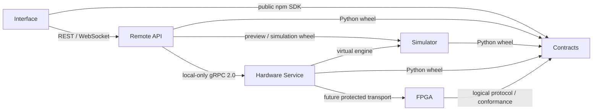

# Multi-Repo Migration M0 Implementation Plan

> **For agentic workers:** REQUIRED SUB-SKILL: Use `superpowers:subagent-driven-development` or `superpowers:executing-plans` only after the user authorizes implementation. Follow the milestone gates and checkbox steps below. Approval of this M0 assessment does not authorize M1.

**Goal:** Ghi lại M0 đã được duyệt và kế hoạch chuyển net*CIRCUIT Remote thành sáu repository độc lập, dùng Contracts và release artifacts versioned, bảo toàn chức năng hiện hành.

**Architecture:** Remote giữ FastAPI modular monolith, orchestration và tích hợp hệ thống. Contracts là nguồn chuẩn của schema, catalog và protocol; Interface, Simulator, Hardware và FPGA sở hữu implementation tương ứng. Mỗi consumer dùng package/artifact được pin, không import source từ sibling repository.

**Tech Stack:** Vue 3, TypeScript, Pinia, Three.js, Python 3.11+, FastAPI, Pydantic, SQLAlchemy/Alembic, JSON Schema 2020-12, Protobuf/gRPC, Verilog, GitHub Actions, Nginx/systemd, PostgreSQL.

**Spec:** Yêu cầu M0 và báo cáo assessment đã được người dùng duyệt trong chat ngày **2026-10-24, Asia/Saigon**; authority tiếp tục là [Lab-First v3.1](../../ARCHITECTURE.md), [Contracts](../../../contracts/README.md) và [verification policy](../../VERIFICATION.md). Tài liệu này không thay thế architecture authority.

**Status:** `M0_APPROVED`; `M1_NOT_STARTED`. Lộ trình M1–M6 dưới đây là kế hoạch cho các yêu cầu triển khai sau. Lần ghi nhận này chỉ tạo tài liệu, cập nhật documentation index và kiểm tra tài liệu; không extraction, code generation, source migration hoặc publish.

## Global Constraints

- SAFETY != CORRECTNESS. UNKNOWN != UNSAFE. TOPOLOGY MISMATCH != RUN BLOCK.
- CircuitGraph schemas 1.0, 1.1 và additive 1.2 tiếp tục là DesignGraph source of truth; Three.js là projection.
- JSON Schemas sở hữu shapes; FastAPI registrations sở hữu public operations; Protobuf sở hữu local RPC fields.
- Hardware RPC giữ local-only; một API scheduler process/worker theo kiến trúc hiện hành.
- Thiếu driver, producer, adapter hoặc bằng chứng hardware phải giữ `UNAVAILABLE`, `NOT_IMPLEMENTED` hoặc capability=false.
- Giữ nguyên lịch sử repository gốc. Chỉ lọc history trên fresh clone tạm sau khi được phép triển khai.
- Không di chuyển/xóa source, tạo branch/commit, stage/push/force-push, deploy, đổi license hoặc tự bắt đầu M1 trong phạm vi ghi nhận M0.
- Không xóa/di chuyển Markdown, historical evidence, source assets, design references hoặc golden baselines nếu chưa có quyết định riêng. Giữ byte/hash và marker được bảo vệ.
- Diagnostic artifacts phải được tạo ngoài mọi checkout/worktree/Git directory ngay từ đầu, bằng shared allocator; chỉ Markdown evidence được giữ trong repository.
- Package version, Graph version, Assignment version, Hardware RPC version, FPGA protocol, firmware và hardware profile là các miền version độc lập.

## Review Focus

1. **Package thiếu resource hoặc lộ private schema:** M1 phải kiểm tra wheel/sdist và nội dung npm tarball thực tế, kể cả private descendants.
2. **OpenAPI release cycle sinh drift:** M1/M6 phải export lại từ Remote trên đúng final Contracts artifact và so sánh snapshot đã freeze.
3. **Catalog mất historical identity:** M1/M2/M3 phải giữ part/pin/package/footprint revisions, historicalParts và explicit rebuild semantics.
4. **Allocator dùng sai repo/session:** M1 phải kiểm tra installed tooling, arbitrary CWD, nhiều Git worktree families, symlink, denied enumeration và inherited cleanup ownership.
5. **Rollback phục hồi package nhưng phá dữ liệu/control:** M4/M6 phải giữ safe cleanup/quarantine, không replay Start; DB rollback dùng matching database/capture backup khi cần.

## 1. M0 preflight đã ghi nhận

Assessment chỉ đọc tại source revision `295797c581acc3935f5e128fd3d23674c728ca65`, branch `master`. Inventory lúc assessment có **1.145 tracked files**, **123 commits trên các ref hiện có**, **0 tags** và repository không shallow. Không có tracked/staged/untracked changes được Git báo cáo.

Repository parent trên máy khảo sát: `E:/ALL_PROJECTS/LUAN_VAN_TOT_NGHIEP/REPO`.

| Repository dưới parent | Branch | HEAD tại M0 | Configured origin |
| --- | --- | --- | --- |
| net-Circuit-Remote | master | 295797c | https://github.com/net-Circuit-Remote/net-Circuit-Remote.git |
| net-Circuit-Interface | master | 0ac420f | https://github.com/TINIHI-Labs/net-Circuit-Interface.git |
| net-Circuit-Contracts | master | a5b17b1 | https://github.com/TINIHI-Labs/net-Circuit-Contracts.git |
| net-Circuit-Simulator | master | b8765d9 | https://github.com/TINIHI-Labs/net-Circuit-Simulator.git |
| net-Circuit-Hardware | master | 2b0005f | https://github.com/TINIHI-Labs/net-Circuit-Hardware.git |
| net-Circuit-FPGA | master | aebac04 | https://github.com/TINIHI-Labs/net-Circuit-FPGA.git |

Năm clone đích chỉ có `README.md` và `LICENSE`, không có local changes được báo cáo. Sáu file LICENSE có cùng SHA-256 và nội dung GPL v3; không thay license. `git ls-remote --heads` đọc được cả sáu remote và refs tương ứng khớp local.

Hai linked worktree `Multi-Repo` và `refactor` đã tồn tại, cùng HEAD `295797c`; không tạo hoặc sửa chúng. Không suy luận dirty state của hai worktree này từ trạng thái checkout `master`.

| Quyền / bằng chứng | Disposition |
| --- | --- |
| Đọc Monorepo, metadata năm clone đích và sáu remote | VERIFIED trong assessment M0 |
| Ghi năm clone đích bằng workspace mặc định | Ngoài writable roots mặc định; không thử ghi |
| Push, publish release/package và CI cross-repo ACL | NOT_VERIFIED |
| GitHub connector | Trả 404 với các repo đã thử; không coi là bằng chứng repo không tồn tại |
| Visibility private của repo đích | Theo thông tin người dùng; Git read không tự chứng minh visibility |

Remote và năm repo mới thuộc hai namespace khác nhau. Download/publish ACL phải được kiểm tra với đúng consumer identity, kể cả đường liên organization. Recheck preflight trước mỗi milestone vì bảng trên là snapshot, không phải live state.

## 2. Repository ownership

Đường dẫn dưới đây là đường dẫn **hiện tại trong Monorepo**, không phải lệnh di chuyển. Giữ layout nội bộ trong lần extraction đầu; chỉ đổi path khi có mapping rõ ràng và consumer tests chứng minh tương đương.

| Owner đích | Source / file groups | Trách nhiệm |
| --- | --- | --- |
| Interface | `apps/web/src/**` trừ generic generated-contract ownership bên dưới | Vue UI, application/domain controllers, Component Library, Editor, electrical/geometry/wires, stores và Three.js |
| Interface | `apps/web/src/assets/**`, `apps/web/public/models/**` | Delivered icons/models/textures, asset hashes và model provenance |
| Interface | `apps/web/package.json`, `package-lock.json`, `vite.config.ts`, `tsconfig*.json`, ba HTML build entrypoints | Locked build và multipage output; giữ dependency versions ban đầu |
| Interface | `apps/web/tests/**`, `apps/web/e2e/**`, `playwright*.config.ts` | Browser/unit acceptance sau khi sửa cross-checkout fixtures và output containment |
| Contracts | `contracts/**` | Manifest/registry, schema, Python boundary, profiles, codecs, fixtures, baselines, protocol và packaged resources |
| Contracts | `device-library/**` | Một canonical owner cho logical/physical identity, port semantics, part/package/footprint/pin revisions và historicalParts |
| Contracts | Root `pyproject.toml`, `setup.py`, `MANIFEST.in`; applicable codegen pins/LF rules | Distribution `netcircuit-contracts`; giữ Python namespace `contracts` |
| Contracts | `apps/web/scripts/generate-contracts.mjs` | Generic DTO/Ajv generation chuyển thành tool của Contracts |
| Contracts output | `contracts/boundary/**`, `contracts/generated/**`, Web DTO/validator/capture-layout/public-name projections | Package-local generated artifacts; không có canonical writer thứ hai trong consumer |
| Interface adapters | `apps/web/src/contracts/validation.ts` và app-specific normalization | Giữ adaptations liên quan document/electrical/application; không chuyển nguyên thư mục một cách máy móc |
| Simulator | `simulator/circuit-simulator/**` | Engine, dispatcher, logic/nets, waveform helpers, bounded physical/DC subset, package và unit tests |
| Hardware | `services/hardware-service/**` | RPC server, station abstraction, virtual/physical adapters, transport và service tests |
| Hardware future | Production driver và station routing/protection/capacity/calibration profiles | Khác với design descriptors trong Device Library; chưa có implementation production để extraction |
| FPGA | `fpga/**`; pure RTL/scaffold cases trong `tests/fpga/**` | RTL, testbench, constraints, board/toolchain và source releases |
| Remote | `services/api/**` | Auth, API, persistence, migrations, scheduler/leases, policy/compiler/resolver, verification, captures và operation recovery |
| Remote | `deployment/**`, `.env.example` | Integrated installation, Nginx/systemd, PostgreSQL, production configuration và runbook |
| Remote | `tests/integration/**`, `tests/deployment/**`, integrated parts của package/RPC/FPGA tests | Whole-system conformance từ released artifacts |
| Remote | `docs/**`, root `assets/**`, root README/LICENSE và protected history | Architecture authority, design references, historical Markdown/evidence và provenance |

Device Library được giữ nguyên một owner ở Contracts trong lần tách đầu. `editor/components.json` cũng đóng góp shared signal identity, nên chưa tách riêng phần này sang Interface. Presentation/rendering code thuộc Interface. Không tạo các catalog editable độc lập. Xem [catalog authority](../../../device-library/README.md) và [physical revision rules](../../../device-library/parts/README.md).

### Scripts, CI và tests

| Files / groups hiện tại | Owner và xử lý |
| --- | --- |
| `scripts/generate_contracts.py`, `generate_python_contracts.py`, `generate_hardware_rpc.py`, `sync_lab_contracts.py` | Contracts; bỏ consumer-tree output assumptions |
| `scripts/sync_editor_catalog.py`, `sync_breadboard_topologies.py`, `check_public_compatibility.py` | Contracts; sinh artifacts trong package, consumer chỉ đọc release |
| `scripts/export_openapi.py` | Route exporter thuộc Remote; tách pure operation-bindings generator sang Contracts |
| `scripts/check_contract_package.py`, `check_release.py` | Integrated gate thuộc Remote; Contracts có gate wheel/sdist riêng |
| `scripts/e2e_web_server.py`, `benchmark_web_sessions.py`, `benchmark_web_contract_bounds.py` | Remote integration/performance harness |
| `scripts/measure-web-bundle.mjs`, Web benchmark/export tooling | Interface |
| `scripts/artifact-paths.mjs`, `artifact-paths.d.mts`, `artifact_paths.py`, allocator self-tests | Contracts-owned dev artifact riêng, không thành runtime dependency của ứng dụng |
| `scripts/check_context.py`, `check_markdown.py`, `check-verification-artifacts*`, `legacy-verification-evidence.json`, documentation/provenance tests | Giữ Remote policy ban đầu; shared allocator không tự kế thừa Remote-specific historical policy |
| `scripts/dev-info.py`, `project_zip.py`, root Makefile và verification/benchmark pins | Remote developer/integration entrypoints; leaf repo có entrypoints/pins cần thiết riêng |
| `.github/workflows/contracts.yml` | Contracts standalone gates; combined consumer gate chuyển thành Remote integration |
| `frontend.yml` | Interface |
| `simulator.yml`, `hardware-service.yml`, `fpga.yml` | Repo tương ứng; sửa install paths, filters, cache và artifact containment |
| `backend.yml`, `integration.yml`, `browser-e2e.yml`, `docs.yml` | Remote API/integration/docs; Interface giữ browser assertions, Remote chuẩn bị backend release set |
| `tests/contracts/**` | Pure contract tests thuộc Contracts; consumer imports tách theo trách nhiệm, không bỏ assertions |
| `tests/frontend/**` | Frontend policy thuộc Interface; catalog parity là consumer conformance; cross-system cases giữ Remote |
| `tests/fixtures/logic-pinouts.json` | Shared catalog conformance fixture thuộc Contracts |
| `tests/fpga/**` | Pure RTL thuộc FPGA; transport assertions thuộc Hardware; combined compatibility thuộc Remote |
| `tests/end-to-end/README.md`, root environment/docs/deployment tests | Remote integration/provenance |

Không đưa ignored caches, venv, node_modules, dist, runtime databases, captures hoặc browser caches vào source extraction/release. Existing historical tracked evidence được bảo tồn, không được coi là output mới.

## 3. Dependency graph và contracts publication

Mũi tên là consumer → dependency:

API đang import Simulator trực tiếp cho physical preview ở [circuits](../../../services/api/app/api/circuits.py) và [placement](../../../services/api/app/api/placement.py). Không bỏ dependency này trong extraction. Hardware implementation không được phụ thuộc API implementation.

Desktop/Mobile là hướng mở rộng, chưa có native packaging/acceptance hiện hành. M2 giữ framework/network-independent document/application controllers; không gộp platform rewrite vào migration.

### OpenAPI handoff không import consumer source

1. Contracts tạo schema prerelease độc lập với snapshot OpenAPI đã duyệt trước đó.
2. Remote candidate cài prerelease và export deterministic OpenAPI từ FastAPI registrations.
3. Freeze reviewed OpenAPI snapshot; Contracts sinh public SDK/operation bindings và final packages từ inputs đã ghi nhận.
4. Remote cài đúng final artifacts, export lại và yêu cầu bằng frozen snapshot; Interface và các consumer chạy gates trên final artifacts.

Giữ route authority ở Remote. Không chỉnh tay snapshot để che route drift. Candidate và final versions phải có metadata/dependency pins tương thích, không thay byte của version đã publish.

### Public/private và generated files

- Python package được mang internal plan/RPC types cần thiết; browser npm artifact chỉ mang public closure.
- Kiểm tra tarball contents, không chỉ TypeScript exports; public parent không được kéo private descendant vào browser.
- Giữ schema URIs, offline resolution, structural/editor/transport profiles, numeric bounds và omission semantics.
- Generated DTO/validator/catalog resources chuyển thành package outputs. Interface giữ adapters/facades cần cho compatibility, không trở thành schema authority.
- Giữ deprecated RPC v1 làm history; không phục hồi raw-graph Run cho consumer mới.

## 4. Blocker register

| ID | Bằng chứng / vấn đề | Owner / gate đóng blocker |
| --- | --- | --- |
| B01 | [Contracts generator](../../../scripts/generate_contracts.py) gọi Web generator và API exporter | M1: standalone generation + frozen OpenAPI handoff |
| B02 | Chưa có standalone npm Contracts package; Web giữ generator dependencies | M1: public npm artifact, export map và tarball-content gate |
| B03 | [Catalog generator](../../../scripts/sync_editor_catalog.py) ghi cả Contracts và Web trees | M1/M2: một canonical owner, package-local outputs, fixture parity |
| B04 | `tests/contracts` chứa API/Simulator/Hardware imports | M1/M6: split test ownership, giữ integrated assertions |
| B05 | CI cài nhiều local editable projects | M1–M6: standalone CI không có sibling sources; installed-artifact gate |
| B06 | Tests dùng `sys.path`, relative fixtures và root codegen scripts | M2–M5: package resources/versioned fixture exports |
| B07 | Web E2E launcher phụ thuộc root Python harness/runtime layout | M2/M6: Interface nhận explicit target, Remote chạy integrated harness |
| B08 | [Allocator](../../../scripts/artifact-paths.mjs) gắn repository/ownership vào vị trí module | M1: explicit roots/context/session owner qua Node/Python/children/cleanup |
| B09 | [Camera](../../../apps/web/playwright.camera.config.ts) và [depth](../../../apps/web/playwright.depth.config.ts) configs còn output trong checkout | M2: sửa containment trước khi chạy các gates này |
| B10 | [Boundary tests](../../../tests/integration/test_repository_boundaries.py) đòi đủ subsystem trong cùng checkout | M6: artifact/dependency assertions tương đương; không chỉ xóa coverage |
| B11 | Publish/download/CI ACL, đặc biệt cross-organization, chưa xác minh | Trước release: authenticated consumer download và controlled publish permissions |
| B12 | Target example ghi FPGA `2.0-scaffold`, [version authority](../../../contracts/fpga-protocol/versions.md) ghi `1.0-scaffold` | M1 review/M5 gate: explicit compatibility ruling; không âm thầm normalize |

Physical runtime thiếu driver vẫn unavailable. B12 không chứng minh board ABI hoặc physical support. OPEN-ABI, OPEN-FRESHNESS và OPEN-HARDWARE tiếp tục theo [FPGA conformance](../../architecture/fpga-contract-conformance.md).

Allocator cần một implementation dùng chung, bảo vệ canonical roots và Git administration/worktree paths của các checkout tham gia. Integration truyền tất cả roots thực sự có; standalone gate không bắt buộc clone năm repo còn lại. Session marker/owner identity phải dùng được từ installed dev tooling và được children/cleanup kế thừa; denied enumeration phải fail closed.

## 5. Git history migration strategy

Chọn **fresh temporary clone + path filtering** thay vì snapshot-only copy vì cần giữ provenance theo subsystem. `git subtree split` theo một prefix không tự bao phủ các nhóm shared root files/catalog/scripts cần chọn ở đây. Không rewrite Remote gốc.

- [ ] Recheck HEAD/refs/dirty state và chốt source revision cùng exact ownership/path mapping trước extraction.
- [ ] Tạo backup refs/bundle đầy đủ, xác minh khả năng phục hồi; giữ source archive/provenance theo policy.
- [ ] Dùng clone tạm riêng cho từng repo; khi clone từ filesystem dùng `git clone --no-local` để tránh local object sharing.
- [ ] Chọn nhiều paths bằng `git-filter-repo`, kiểm kê cả old paths/renames; không dùng `--force` để vượt fresh-clone guard.
- [ ] So sánh filtered tree/file content, tác giả/thời gian và lịch sử liên quan; giữ source SHA và commit mapping trong migration provenance.
- [ ] Trong clone tích hợp tạm, giữ cả initial target commit và extracted ancestry; giải quyết README/LICENSE rõ ràng, không ghi đè history đích.
- [ ] Sau acceptance và authorization phù hợp, dùng migration branch/PR thông thường. Không mirror-push hoặc force-push lên original/target.
- [ ] M6 chỉ gỡ source dư thừa bằng thay đổi thông thường với exact path list đã review; old docs/evidence vẫn cần quyết định riêng nếu đề xuất xóa/di chuyển.

Filtered commits thường đổi SHA; một commit chung có thể có mapping khác nhau giữa các repo và commit không còn nội dung có thể bị prune. Không hứa giữ nguyên mọi SHA hoặc mọi merge topology. Original repository và mapping là provenance anchors. Mọi stdout/log/verification report của migration phải được redirect ra allocator-owned external session từ đầu.

Tool reference: [git-filter-repo documentation](https://github.com/newren/git-filter-repo/blob/main/Documentation/git-filter-repo.txt).

## 6. Build, release và integration manifest

| Repo | Artifact | Consumer / release gate |
| --- | --- | --- |
| Contracts | Python wheel/sdist; public npm SDK; schema/proto/catalog bundle | Clean installed resources, public closure, deterministic generation và consumer parity |
| Contracts dev tooling | Independently versioned Node allocator + Python bridge | Bootstrap trước diagnostic generation; không phụ thuộc schema build/test |
| Interface | Static Web bundle, asset hashes và build metadata | Remote deployment; giữ same public origin cho Web/API/WebSocket |
| Simulator | `netcircuit-simulator` wheel/sdist | API preview và Hardware virtual execution |
| Hardware | `netcircuit-hardware-service` wheel/sdist | Separate installed service environment; local-only RPC |
| FPGA | Source/scaffold release; board artifacts khi có thật | Logical conformance; physical promotion cần evidence riêng |
| Remote | `netcircuit-api` wheel/sdist; integration release manifest; deployment templates | One API process, PostgreSQL/capture persistence và integrated acceptance |

Distribution đề xuất: private GitHub Release assets cho Python/Web/FPGA; GitHub Packages cho npm, với scope dự kiến `@tinihi-labs/contracts` sau khi xác nhận namespace/ACL. Không giả định GitHub Packages cung cấp PyPI registry. Downloader pin repository/release/asset/digest, không lấy `latest`.

External wheelhouse chứa project wheels và **toàn bộ third-party dependency closure** theo Python/platform. Gate dùng locked hashes, network-disabled installation, `pip check` và external import-path assertions. Kiểm tra sdist/build dependencies riêng để PEP 517 isolation không âm thầm tải ngoài lock. Không publish version đã tồn tại với bytes khác.

Mỗi repo có version/changelog riêng. Initial extraction giữ Python namespaces `contracts`, `app`, `netcircuit_sim`, `hardware_service`. Không dùng `file:../...`, npm link, editable sibling install, `PYTHONPATH` hoặc `sys.path.insert` liên repo trong standard build/release path.

| Version domain tại M0 | Value |
| --- | --- |
| Contracts distribution | 1.0.0 |
| API / Web / Simulator / Hardware distributions | 0.1.0, độc lập nhau |
| OpenAPI dialect / application-info | 3.1.0 / 0.2.0; khác API distribution version |
| CircuitGraph | 1.0 / 1.1 / additive 1.2 |
| Assignment / Physical Lab | 1.0 và opt-in 2.0 / 1.0 |
| Hardware RPC | 2.0 |
| NCAP | digital v1; sampled-v2 formats/codecs, chưa có runtime sampled producer mặc định |
| FPGA logical / register framing | 1.0-scaffold / 1.0-reserved, physical ABI chưa chốt |
| Physical firmware/profile | UNAVAILABLE khi thiếu validated driver/hardware evidence |

Remote sở hữu proposed `integration/releases/<release-set>.json`. Chưa tạo file này trong M0. Manifest sẽ ghi commit/version từng repo, artifact filenames/digests, canonical source fingerprint, public-schema fingerprint, OpenAPI digest, dependency/toolchain locks và gate results. Python/npm artifacts có contents khác nhau nên không yêu cầu cùng artifact hash.

Ma trận tối thiểu: stable set toàn hệ thống; Contracts candidate với mọi consumer; Interface candidate với API được hỗ trợ; Simulator candidate với API preview và Hardware virtual; Hardware candidate với RPC/NCAP/lifecycle; FPGA candidate với logical/RTL conformance. Chỉ đưa candidate vào stable manifest sau đúng integrated gates. Chưa gán candidate version hoặc artifact digest giả định trong M0.

Registry references: [GitHub Packages](https://docs.github.com/en/packages/learn-github-packages/introduction-to-github-packages), [npm authentication/consumer access](https://docs.github.com/en/packages/working-with-a-github-packages-registry/working-with-the-npm-registry).

## 7. Milestone tasks và acceptance gates

### M0 — Preflight & Architecture Assessment

**Deliverable:** Tài liệu này ghi nhận assessment đã duyệt; implementation roadmap vẫn chưa chạy.

- [x] Đọc authority, cấu trúc, manifests, generation, CI và source boundaries liên quan.
- [x] Kiểm tra Git/source revision, target clone locations và remote read access.
- [x] Ghi ownership, dependencies, blockers, history strategy, release/versioning và rollback.
- [x] Phân biệt historical verification với kết quả mới; ghi rõ ACL/hardware/deployment chưa xác minh.
- [x] Người dùng duyệt M0 và yêu cầu lưu kế hoạch ngày 2026-10-24.
- [x] Hoàn thành documentation verification của lần lưu này, ghi vào [M0 record](../../verification/2026-10-24-multi-repo-migration-m0.md).

**Rollback:** Chỉ có documentation additions/index update trong lần lưu này; không có runtime/source migration để rollback. Không tự revert tài liệu người dùng đã yêu cầu.

### M1 — Contracts

**Files/ownership:** Contracts, Device Library, packaging/generators và pure conformance theo mục 2; proposed package-local npm exports và separate dev-tool artifact.

**Consumes:** Current schema/catalog/proto/baselines và reviewed OpenAPI snapshot. **Produces:** Immutable Python/public npm artifacts, resource/fixture exports, source/public fingerprints và tooling usable outside a checkout.

- [ ] Recheck preflight/access; chốt exact extraction allowlist, immutable baseline inventory và candidate version policy.
- [ ] Extract trên fresh clone; giữ namespaces, URIs, descriptor revisions và history mapping.
- [ ] Tách generator khỏi Web/API checkout, áp dụng OpenAPI handoff ở mục 3; không đổi route authority.
- [ ] Bootstrap independent allocator dev artifact; kiểm tra explicit roots/ownership từ Node, Python, children và cleanup.
- [ ] Build wheel/sdist/npm tarball độc lập; kiểm tra Python 3.11/3.12 external installs, offline refs, deterministic bytes, numeric/omission parity và private-descendant exclusion.
- [ ] Chạy existing pure contract tests, public compatibility/NCAP/RPC anchors và từng consumer trên candidate rồi final artifacts; `pip check` phải sạch.

**Acceptance:** Không cần source consumer để build/generate Contracts; Remote re-export trên final artifact bằng frozen OpenAPI; tarball/resources đúng; không đánh đổi baseline assertions để đạt PASS.

**Rollback:** Pin lại previous approved artifacts, giữ Monorepo chạy được; không overwrite package version hoặc chỉnh baseline để che drift.

### M2 — Interface

**Files/ownership:** Web product/toolchain/assets/tests; app adapters giữ Interface, generic generator thuộc Contracts. **Dependency changes:** pinned public Contracts npm/resources và explicit Remote test target.

- [ ] Extract giữ Vue/workbench structure, dependency versions và package-lock; không redesign Editor hoặc thêm native platform packaging.
- [ ] Thay relative contract fixtures/snapshots bằng package exports; giữ normalization, Graph compatibility và historical part lookup.
- [ ] Update AST allowlist cho approved pure Contracts entrypoints; giữ renderer/network/private-hardware boundaries và cycle checks.
- [ ] Tách integrated backend startup sang Remote; sửa specialized Playwright output/launcher theo verification policy trước khi chạy chúng.
- [ ] Chạy clean install không sibling source, unit/type/boundary/multipage build/E2E typecheck và real browser gate với pinned backend set.
- [ ] Kiểm tra Component Library/search/thumbnails; placement/ghost/gizmo; wire/contact; Undo/Redo/clipboard; Graph 1.0/1.1/1.2; persistent canvas/assets; auth/project/assignment/recovery/capture flows.

**Acceptance:** Same-origin cookie/CSRF/WebSocket và asset paths giữ nghĩa; no replay/control authority escalation; không có source path sang repo khác. Desktop/Mobile vẫn là roadmap riêng.

**Rollback:** Khôi phục static artifact và release pin trước đó; giữ browser origin, principal-scoped storage, saved graph và server data semantics.

### M3 — Simulator

**Files/ownership:** Toàn bộ Simulator package/unit tests. **Dependency changes:** released Contracts, package-resource fixtures, không sibling import.

- [ ] Extract giữ engine/dispatcher/public preview imports và current model support.
- [ ] Chuyển tests từ hardcoded source/fixture paths sang installed resources.
- [ ] Build wheel/sdist; cài ngoài checkout với dependency locks và không editable install.
- [ ] Chạy deterministic event ordering, propagation, nets, power-aware/DC subset, domain rejection và worker budget tests.
- [ ] Chạy Remote preview và Hardware virtual execution trên cùng released package.

**Acceptance:** Digital/current bounded subset tương đương; analog/SPICE/mixed vẫn unavailable khi thiếu adapter; không suy luận model support từ khả năng place/render.

**Rollback:** Restore prior Simulator/Contracts release pins; không convert documents/captures.

### M4 — Hardware

**Files/ownership:** Hardware Service, station/transport implementation và tests. **Dependency changes:** Contracts + Simulator wheels; RPC bindings đi cùng Contracts.

- [ ] Extract service/package; giữ separate process, local-only bind và no API implementation dependency.
- [ ] Bỏ test-time root codegen/sibling sys.path; giữ lifecycle/worker assertions.
- [ ] Kiểm tra installed-wheel RPC v2, NCAP payload/metadata consistency và no-driver unavailable behavior.
- [ ] Kiểm tra fresh scan/safety/plan, malformed driver evidence, allocated resources, cancellation/Stop isolation, safe release/quarantine và stale/profile revocation.
- [ ] Chạy real RPC integration với Remote và actual virtual worker execution; test drivers không trở thành physical capability evidence.

**Acceptance:** Không bypass guarded lifecycle; Stop không bị CPU simulation giữ control path; failed safe cleanup không release resources; physical flags/slots/channels vẫn đúng capability truth.

**Rollback:** Ngừng admission, drain/stop với acknowledged safe cleanup hoặc quarantine; restore prior compatible wheel set; giữ persisted leases/quarantine và không replay Start.

### M5 — FPGA

**Files/ownership:** FPGA sources/testbench/toolchain và pure RTL tests. **Dependency changes:** pinned logical protocol/conformance bundle; Hardware transport implementation vẫn thuộc Hardware.

- [ ] Extract scaffold với exact source/protocol identity và history provenance.
- [ ] Giải quyết B12 bằng compatibility ruling; không gộp logical scaffold với physical ABI/firmware version.
- [ ] Chạy parser/compiler và behavioral simulation gates bằng toolchain đã pin; ghi rõ tool nào unavailable.
- [ ] Kiểm tra reset, Stop/fault/watchdog/permit loss, fail-closed drive/routing và disabled instrument outputs.
- [ ] Chạy Hardware/FPGA conformance từ released inputs; tách physical promotion khỏi software scaffold acceptance.

**Acceptance:** Chỉ claim đúng software/RTL evidence. Không claim pinout, switching, electrical protection, synthesis/timing/CDC, ADC/DAC/SDRAM hoặc real acquisition nếu chưa có implementation/evidence tương ứng.

**Rollback:** Restore prior source/protocol compatibility set. Chưa có board image/programming procedure thì không claim board rollback đã được kiểm chứng.

### M6 — Remote Integration

**Files/ownership:** API, deployment, integrated tests/release runner và proposed compatibility manifests. **Dependency changes:** released Contracts/Simulator wheels, installed Hardware service và Interface build artifact.

- [ ] Rework integration/package/browser harness để dùng explicit artifacts, không source siblings hoặc editable imports.
- [ ] Thay monorepo-directory assertions bằng installed artifact/resource/dependency checks có coverage tương đương.
- [ ] Build API wheel và assembled release set; kiểm tra OpenAPI final equality, supported wire anchors và private projections.
- [ ] Chạy Contracts/Python/Web/PostgreSQL/browser/package gates và W0–W8 regression matrix; workload/target/hardware evidence ghi riêng.
- [ ] Rehearse matching database/capture backup/restore, lease/quarantine recovery và prior-release rollback; giữ một API worker/local-only RPC/same public origin.
- [ ] Review exact paths source ngừng duy trì trong Remote trước khi gỡ bằng ordinary change; không tự xóa/di chuyển historical Markdown/evidence.

**Acceptance:** Sáu repo build/release độc lập; toàn hệ thống chạy bằng approved artifact set; không source import xuyên repo; rollback và registry ACL được chứng minh.

**Rollback:** Khôi phục previous release set. DB đã upgrade dùng matching verified database/capture restore khi cần; không automatic downgrade. Không replay commands hoặc bỏ quarantine để khởi động nhanh hơn.

## 8. W0–W8 và invariants phải bảo toàn

| Phạm vi | Regression evidence bắt buộc |
| --- | --- |
| W0–W1 | Baselines/provenance, offline references, deterministic generation, numeric precision/profiles, omission và Python/browser parity |
| W2 | Route/request/response/error/security/media anchors, public projections và bounded realtime resync |
| W3 | Auth/CSRF/session/ownership fencing, forward migrations và restart recovery |
| W4 | Projects, immutable revisions, CAS, Save As identity và stale-save acknowledgement |
| W5 | Component Library/Editor, commands/history, controller boundaries, persistent canvas, asset integrity/resource ownership |
| W6 | Assignment publication/disclosure; durable operation recovery; reload/reconnect không replay Create/Run/Apply |
| W7 | Signal domains/dispatcher, NCAP v1/v2 separation, capture access/raw evidence, truthful instruments và unavailable paths |
| W8 | Real installed artifacts ngoài checkout, PostgreSQL migrations/backup/races, browser thật và integrated release gates |

Safety/topology/function/assessment giữ độc lập. Routing dựa trên observed student nodes và resource thật, không tái tạo expected wiring. Physical Start yêu cầu fresh safety/scan, matching executable plan, applied routing, guarded power và capture readiness. Safe cleanup thất bại giữ quarantine. Browser không nhận private routes/registers/plan; historical selection/reconnect không tự có Run/Stop authority của tab khác.

[W0–W8 ledger](../../verification/2026-10-16-web-contracts.md), [WC20 closure](../../verification/2026-10-20-web-contracts-closure.md) và [latest recorded CI repair](../../verification/2026-10-21-github-actions.md) là historical evidence. Cancelled/failed/incomplete browser gates không biến thành PASS vì migration plan được duyệt.

## 9. Final migration acceptance checklist

- [ ] Exact file ownership/rename map được review; mỗi canonical input chỉ có một owner.
- [ ] Source/target refs và backup/history mapping được xác minh; original history không rewrite/force-push.
- [ ] Target write scopes và package/release/download/CI ACL được chứng minh với đúng identities.
- [ ] Mỗi repo build/test độc lập không sibling sources; clean installed imports nằm ngoài checkout.
- [ ] Python/npm resources đúng, public tarball không có private descendants; catalog history và schema URIs được giữ.
- [ ] FastAPI export trên final artifact bằng frozen OpenAPI snapshot.
- [ ] Không source imports, fixture reads hoặc codegen writes xuyên repo trong supported release path.
- [ ] Component Library, Editor, CircuitGraph, API, preview và simulation giữ supported behavior.
- [ ] Auth/projects/assignments/captures/control/lifecycle/W0–W8 integrated gates có fresh evidence.
- [ ] Allocator bảo vệ involved roots/Git dirs; diagnostics external ngay từ đầu; inspection và guarded cleanup hoàn tất.
- [ ] Compatibility manifest ghi exact versions/digests và rollback rehearsal của đúng release set.
- [ ] Physical/deployment/target-capacity promotion chỉ theo evidence riêng, không suy luận từ software PASS.

## 10. Handoff

Người dùng đã duyệt **M0**. Lần yêu cầu hiện tại chỉ lưu bản kế hoạch này. M1–M6 chưa được thực hiện; không tự chạy commands trong roadmap hoặc áp dụng một historical prompt như lệnh triển khai mới.

Khi được yêu cầu bắt đầu M1, đọc lại authority, plan, [M0 verification record](../../verification/2026-10-24-multi-repo-migration-m0.md) và trạng thái Git/access mới; chốt exact task/file/test plan cho M1 trước implementation. M0 approval không cấp quyền stage/commit/push/deploy.
