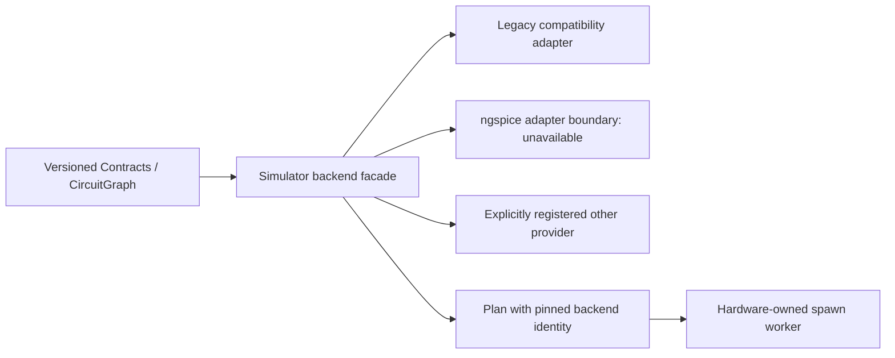

# Replaceable simulation backends — M3B design

Date: 2026-10-27, Asia/Saigon. User instruction: prepare the Simulator repository for a future ngspice core or another core, rather than developing a new solver. The user explicitly selected preparation of a replaceable backend boundary while preserving current features; real ngspice execution is not requested in this phase. This extends M3, not M4. No commit, push, merge, deployment, native dependency installation or license change is authorized.

## Current coupling and the selected approach

The verified M3A package `0.1.1` already separates source ownership. It still exposes engine-specific entrypoints: two Remote preview routes import `engine.preview_physical_graph`; Hardware compiles through `SimulationDispatcher`, reads `plan.directions`, then submits `engine.run_plan` to its existing spawn pool. The dispatcher classifies signal domains using Contracts. Preview deliberately admits bounded unsupported device states, while execution compilation rejects unsupported models. Those paths cannot be merged without changing behavior.

The selected implementation is an additive Python provider interface in `netcircuit_sim.backends`. All eight original modules remain unchanged and documented as legacy compatibility. The new default `legacy` provider delegates their existing functions. Active API and Hardware consumers switch to the new facade. This preserves old callers using `engine.run_plan(SimulationDispatcher().compile(graph))` and avoids writing another solver.

Alternatives considered: replacing the legacy engine now would remove working digital/DC behavior before a native adapter exists; adding only an environment switch around the old dispatcher would leave preview and the spawned worker bypassing selection. Loading arbitrary module paths from configuration would also make plan identity and worker composition difficult to audit. The additive, explicitly composed provider boundary solves these concrete issues without a native integration in this phase.

## ngspice research and future integration

The [official shared-library documentation](https://ngspice.sourceforge.io/shared.html) describes `.so`/`.dll` builds, netlist submission, simulation callbacks, background execution and stop/resume controls. The [official manual](https://ngspice.sourceforge.io/docs/ngspice-manual.pdf) also describes batch execution and raw output. These are two possible implementations behind the same application adapter; neither requires making the UI depend on ngspice internals. The [manual index](https://ngspice.sourceforge.io/docs.html) distinguishes release manuals from development documentation.

Engineering recommendation, not a claim of current support: keep a future native ngspice library inside a controlled worker process, with a pinned upstream source revision/build configuration and model artifacts. A batch subprocess can provide an initial adapter, while a shared-library adapter can provide tighter callbacks later. Both need explicit ownership of native state, bounded output, deadlines and acknowledged cancellation. The existing Python Future cancellation is not proof that a native solver has stopped. Native processes/libraries, callback lifetimes, reset semantics and crash recovery need their own tests before enabling capabilities.

CircuitGraph is not a SPICE netlist. A later adapter must map actual explicit nets, pin identities, grounds/references, component properties and model revisions; preserve a stable map between graph endpoints and solver vectors; and reject unsupported or ambiguous models rather than guess connectivity from geometry. Canonical component identity stays in Contracts. Native model files and adapter-specific compilation belong to Simulator and must be versioned separately from the upstream engine.

Current execution captures contain digital observations `0/1/X`; sampled NCAP v2 support elsewhere does not provide a runtime analog producer. Native floating-point seconds/voltages cannot be cast into digital samples without a deliberate timebase, threshold, unknown-state and result-model policy. Real analog/mixed output will require an explicit compatible Contracts/consumer decision. This phase advertises no new analog, Scope or Generator capability and launches no ngspice process.

Before enabling a real ngspice provider, the follow-up must establish five concrete deliverables: (1) reproducible upstream source/build artifacts and platform ABI; (2) versioned device-model and CircuitGraph-to-netlist mapping with explicit unsupported cases; (3) operating-point/transient result mapping with numerical tolerances, units and signal identity; (4) bounded worker execution, cancellation/native cleanup and crash recovery; (5) actual integration/compatibility evidence before promoting capability flags. Tests of the current ideal 8 ns digital model are compatibility tests, not a physical reference that every SPICE result must reproduce.

The initial envelope's ID/adapter-version/plan-format tuple binds this Python provider protocol. It is not sufficient provenance for a future native solver by itself: that adapter's payload must additionally record and verify native artifact/build and model-set identity before execution. The future adapter can be implemented with a direct C API binding or a reviewed binding library; choosing one now would add dependencies without proving the still-missing graph/result mapping. Native source integration and its notices remain a separate, explicitly reviewed change.

## Provider contract and selection

The additive package API includes an immutable backend identity (ID, adapter version, plan format version), capability/availability metadata, an explicitly composed registry, a compiled-plan envelope, and `compile_graph`, `run_plan`, `preview_physical_graph` facades. Providers implement compile, execute and preview. Their payload is process-serializable, internal trusted data; it cannot contain a live DLL handle, callback pointer or process object. `.directions` remains available for Hardware endpoint validation.

Built-ins are `legacy` and `ngspice`. Legacy keeps existing digital/DC behavior and four Logic Analyzer channels. Ngspice is a registered unavailable adapter boundary: no executable discovery, DLL loading, subprocess, samples, automatic fallback or claim that installation alone provides model support. Unknown/empty selection fails clearly. A trusted provider object can be supplied in an explicitly constructed registry to implement another core. Registry IDs cannot collide; parent-only registry mutation must never silently produce another backend in a spawned worker. No environment-driven Python module imports or automatic plugin discovery is added.

`NETCIRCUIT_SIMULATION_BACKEND` selects the configured backend, default `legacy`. API Settings snapshot that selection when created; Hardware stations snapshot it at construction. Graph/request data cannot select a core. A compiled plan records the complete backend identity. Worker execution resolves and checks that identity in its own explicitly composed registry, ignoring ambient environment selection; a missing provider, adapter mismatch or plan-format mismatch fails without executing legacy code. Future custom workers must compose the same installed provider registry in each process.

Design review clarified three implementation decisions. Current service composition exposes only the two built-ins; the facade's explicit registry is the extension point for other providers, not an automatic service plugin loader. A real custom-provider spawn/reused-pool test composes its registry inside the trusted worker; a parent-only registration fails without fallback. Semantic unavailable/unsupported/identity errors use the existing `SimulationError` boundary, while invalid startup selectors use a clear configuration error. Finally, execution-relevant provider configuration belongs in the compiled payload; execution cannot reselect models/options from ambient environment after compilation. Unexpected provider implementation bugs remain errors, not successful or fabricated unavailable results.

## Consumer behavior and unchanged authority

Both preview routes keep operation IDs, response/error shapes and property normalization, but use the application's frozen selection. Hardware retains its locks, pool budget, control threads, generation checks, Stop/reset, timeout, aliases and capture persistence. Only compile/execute routing and capability derivation change. An unavailable ngspice station reports available=false, digital=false, analog=false and zero instrument channels, so existing admission rejects execution. Legacy capability values remain exactly compatible. No scheduler, physical driver, safety policy, database schema or browser redesign is needed.

## Versioning, verification and rollback

Publishable candidate version is `netcircuit-simulator==0.2.0` with Contracts `1.0.1`; no publication occurs here. Preserve the immutable reviewed `0.1.1` artifacts as the M3A rollback baseline. Update consumer pins, exact wheel inventories, standalone/Remote CI and documentation together. Record additional facade modules separately from the unchanged eight-module legacy inventory.

Tests must prove legacy compile/run/preview parity, deliberate preview permissiveness, ngspice unavailable/no launch/no fallback, unknown and duplicate rejection, a trusted alternative provider receiving all three operations, identity/version/format tampering rejection, pickle round-trip and real spawn execution after environment changes. Consumer tests cover both preview routes with independently frozen app settings, truthful station capabilities, existing worker Stop/generation lifecycle and real REST/RPC execution. Re-export OpenAPI and require equality. Build wheel/sdist from fresh exports, install from hashlocked offline inputs outside checkout, verify exact archive provenance and inspect final artifacts before cleanup.

Rollback selects backend `legacy` for normal operation, or restores the reviewed `0.1.1` package together with matching prior consumer code/metadata if rolling back this additive API. Do not run newer consumers against a package lacking the facade. No document/capture conversion, command replay or quarantine clearing is involved.
