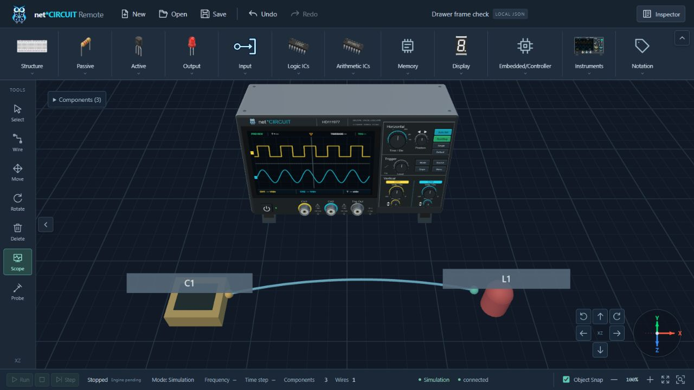
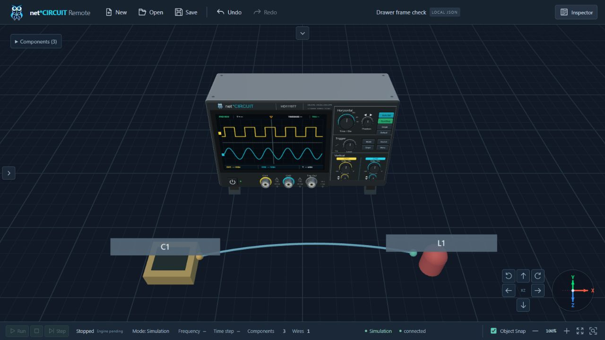

# Fixed drawer dimensions — 2026-10-11

Base: `262ba84` (`update`); clean checkout at task start. Manual drawer sizing is removed per the latest request. Earlier resizable-panel/performance/overlay reports describe historical revisions.

## Source and behavior

Read the two drawer components, resize/motion helpers, UI store, shell, workspace obstacle/viewport integration, CSS and related tests/docs before editing. Removed separator handles, pointer capture and keyboard sizing, resize helper and its five tests, dimension preferences/max getters/setters, the motion resizing callback/watcher and CSS handle/is-resizing rules. Removed the always-on has-size class while retaining the same family-button computed height:auto. Removed the redundant CSS sidebar-width override; UI-derived dimensions remain the shared source for panel geometry and safe areas.

Components stays96 px; Tools66 px, or54 px when workbench width is560 px or less. The Tools opener's swept gizmo corridor uses the fixed ribbon height. Both mounted drawers keep200 ms translate3d/cubic-bezier(.22,1,.36,1), persistent outer toggles, inert/aria-hidden and post-motion visibility, rapid reversal/post-commit settlement and reduced motion. Palette/drag payload/icons, window focus/drag/bounds, contextual safe areas and graph/editing state remain intact.

SingleWorkspaceShell, frameTasks and SceneManager were inspected and require no changes: the stage always fills the workbench; true viewport changes still coalesce/deduplicate via RAF and resize buffers with drawing. Menu toggles do not resize the WebGL viewport.

## Automated checks

- Simplified motion API test first failed TypeScript against the old required resizing callback, then passed after cleanup.
- `npm test`:181/181 pass, including TypeScript. Retains collapse/graph/history/editing-state, same-frame and rapid reversal, occupancy, reduced-motion/listener disposal, duplicate-viewport and renderer/camera tests. Adds initial reduced-motion repeated toggles and responsive boundary/window safe-area coverage; obsolete manual-size cases are removed.
- `npm run build`:PASS;135 modules. Existing large-chunk advisory remains.
- Root `$env:PYTHONPATH='.audit-runtime'; python -m pytest -q`:97/97 pass; three existing deprecations.
- `python scripts/check_context.py` and `git diff --check`:PASS.
- Reference scan in application source/tests: no deleted resize API, helper, handle classes, resizing motion branch or Resize Components/Tools labels. Genuine viewport observers, floating-window movement and unrelated textarea resize remain functional.
- Independent read-only source/test review against the base: no actionable findings. Browser appearance/timing and docs were verified separately.

## Browser checks

Used the native Codex browser on local Vite with an ignored authored diagnostic fixture mounting the real App, Pinia and source CSS. Fixture: Oscilloscope, Clock, LED and one logical connection. Diagnostic hooks count canvas width allocations, canvas ResizeObserver deliveries and UI viewport/workbench/editor-cancel actions; WebGL uniforms capture view/projection matrices. RAF samples inspect visible canvas/buffer geometry and drawer transforms. Hooks exist only in the ignored fixture.

Normal-motion nine reversals35 ms apart sampled80 frames: CSS canvas1280×629 and buffer1600×786 throughout,55/56 distinct drawer transforms, zero aspect-mismatch frames, zero buffer allocation/canvas observer/viewport/workbench/editor-cancel calls. View/projection matrices and graph unchanged. Ten draws reflect target/obstacle updates; no product per-frame animation loop is added. Same-frame expand/collapse returns hidden obstacle occupancy without a transition event; canvas/camera/graph stay unchanged.

Reduced-motion nine reversals sampled57 frames with only two endpoint transforms, the same canvas/buffer, no aspect mismatch or camera/graph change, and no resize-pipeline calls. Scope opened at local66/96 and keeps that position on collapse. Browser viewport overrides560/561/320×480 produce Tools54/66/54 and Ribbon96; window headers stay outside open drawers, with no document horizontal overflow. Both separators are absent. Final runtime error/warn logs are empty. Viewport override restored and test tab/server closed after QA.

Evidence images retain the same model/wire scale and position with drawers visible and hidden:

This verifies the exercised local fixture and browser sizes; it is not a benchmark for every GPU or circuit. Simulation controls retain their existing unavailable/pending execution state.

## Files changed

- Source: ToolRail.vue, ComponentRibbon.vue, CircuitWorkspace3D.vue, useDrawerMotion.ts, ui.ts, style.css; delete usePanelResize.ts.
- Tests: workbench.test.ts, drawerMotion.test.ts; rename the camera viewport test to describe actual viewport changes; delete panel-resize.test.ts.
- Current docs: apps/web/README.md, CONTEXT.md, ARCHITECTURE.md, ROADMAP.md, CHANGELOG.md, DEV_LOG.md and SOURCE_ANALYSIS_COLLAPSIBLE_TOOLBARS.md; this verification report and two screenshots.

No dependency, Circuit Graph, schema, model/icon, simulation-control, transport or hardware architecture changes. No commit/push/deployment performed.
