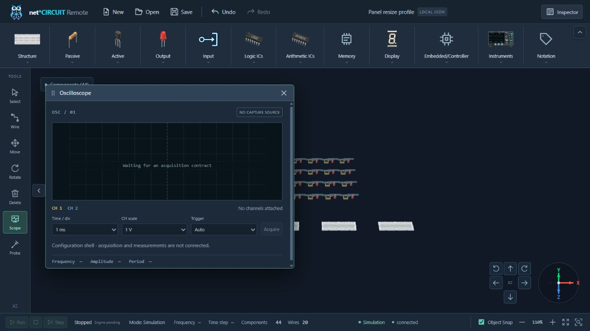
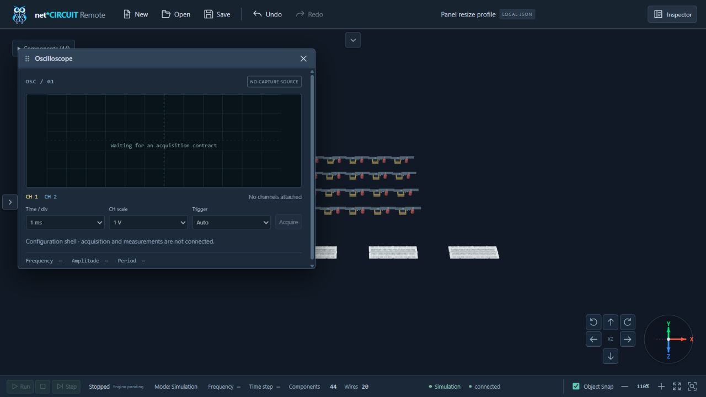

# Kiểm chứng tối ưu resize panel — 2026-10-11

Base: `80b6f90` (`update`). Workspace sạch khi bắt đầu. Thay đổi chưa commit/push/deploy.

## Phương pháp và kết quả trước/sau

Probe tạm trong `.test-build` mount App thật, Pinia thật, stylesheet thật và WebGL thật. Mạch có20 Clock,20 LED,4 Breadboard,20 dây Clock.OUT→LED.IN; Scope mở. Click các toggle thật tại1280×720, reset counters trước từng thao tác. Không đưa probe/dependency/instrumentation vào source hoặc production bundle.

Đếm drawing-buffer width writes của canvas workspace (đường `WebGLRenderer.setSize`), ResizeObserver callbacks, UI actions và WebGL clear mỗi draw. `cancelZoomArea` là proxy cho editor.cancel trong resize. DOM counters ở nút còn gồm các phép đo locator tự thực hiện; chỉ host/floating-window counts dùng để so sánh ứng dụng. Không đo thời gian GPU/FPS hay suy ra bảo đảm cho mọi máy từ số callback.

| Thao tác | Canvas RO trước→sau | setSize trước→sau | Cancel / viewport trước→sau | Draw trước→sau | Host DOM rect trước→sau |
| --- | --- | --- | --- | --- | --- |
| Collapse Components | 13→1 | 13→1 | 13→1 | 13→1 | 26→1 |
| Collapse Tools | 12→1 | 12→1 | 12→1 | 12→1 | 24→1 |
| Expand Components | 11→1 | 11→1 | 11→1 | 11→1 | 22→1 |
| Expand Tools | 15→1 | 15→1 | 15→1 | 16→1 | 31→1 |

Sau tối ưu mỗi thao tác chỉ đo Scope một lần, thay vì11–16 lần. Palette đóng không đo component-panel nữa. Hai wrapper có transition-duration0s; opacity reveal không thay đổi box size. Buffer cấp phát cùng frame vẽ, được kiểm chứng bằng test thứ tự và suspend/restore.

Năm chu kỳ nhanh (20 toggles) ghi20 canvas RO/cancel/viewport/setSize,25 draws. Năm draw thêm từ pointer hover/leave khi nút và canvas đổi vùng dưới chuột không có thêm obstacle DOM measurements. Năm lần Orbit right có5 draws,0 buffer/viewport/obstacle DOM work. Zoom giữ110%, mạch giữ44/20.

## Giao diện thực, không có probe

App `/` đọc cùng fixture JSON qua nút Open/FileChooser thật; Fit, Zoom In và Scope qua nút thật. Các phép đo DOM chỉ đọc giao diện.

- Expanded mặc định: Components96 px, Tools66 px, canvas1214×533. Scope tọa độ local32/36,540×400.
- Collapsed cả hai: Components height0, Tools width0, canvas1280×629. Hai edge toggles hiện rõ, Scope local32/36 và kích thước giữ nguyên.
- Enter/Space mở lại: toàn bộ snapshot layout/axes/zoom/simulation-status/Undo-Redo/Scope giống trước. Heading hiển thị qua SVG axes giữ nguyên; test SceneManager kiểm tra trực tiếp camera position/quaternion, magnification, matrices và graph connections.
- Native drag đổi Components180 px, Tools150 px; canvas1130×449. Collapse/reopen khôi phục180/150. Home/End reach min/max96–260 và54–180.
- Responsive390×480: expanded panel height150.59 px, canvas≈240.4×180; collapsed canvas≈390.4×330.6. Scope clamp theo viewport, hai toggle vẫn thấy, không document horizontal overflow.320×480 canvas expanded200×180, không overflow.1920×1080 khôi phục preference180/150; zoom vẫn110%.
- Info đang mở/topmost: chọn Clock rồi Breadboard830 qua inventory thật làm height311.4→346.6 px; một obstacle scan/draw,0 setSize/viewport. Cache được invalidated đúng nội dung mới.
- Scope header ArrowRight/ArrowDown vẫn di chuyển cửa sổ10/10 px; Escape khi cả hai toolbar ẩn trả focus về Expand Tools. Input palette neo đúng trigger x402.98 px, width530 px trong viewport1280; chọn Clock còn arm placement, canvas Escape hủy đúng và giữ44/20. Console warning/error và graphics/editor/file error notices đều rỗng. Các tab test đã đóng và viewport override đã reset.

Floating windows vẫn clamp theo khả năng hiển thị của workspace nhỏ như hành vi trước. Run/Stop/Step giữ trạng thái hiện hành; engine/capture còn pending, không mô phỏng dữ liệu hoặc claim physical execution.

## Test và build thực sự chạy

| Kiểm tra | Kết quả |
| --- | --- |
| `npm test` | **178/178 PASS**,0 fail/skip; test và production type checks theo script hiện có. |
| `npm run build` | **PASS**, vue-tsc/Vite,135 modules; existing >500 kB advisory. |
| `PYTHONPATH=.audit-runtime python -m pytest -q` | **97/97 PASS**,3 existing dependency deprecation warnings; toàn bộ test repo/API/hardware/simulator/contracts/frontend/FPGA scaffold. |
| Independent final code review | Không còn actionable finding; selected-info-height regression đã được sửa và kiểm chứng. |
| Context / whitespace | Context-check nằm trong full pytest PASS; `git diff --check` PASS. |

Ba nhóm regression mới:3 observer/frame tasks,3 SceneManager frame/buffer tests,1 UI duplicate-size test. Có RED trước fix cho duplicate allocations/store identity và buffer cleared before redraw. Existing tests giữ coverage editor, wire/model lifetimes, camera preservation, resizing/capture and store history. Python sandbox launch bị treo ở path resolution và đã terminate; chạy external được phê duyệt PASS. Không cài dependency mới.

## Files thay đổi

Production:

- `apps/web/src/components/workbench/CircuitWorkspace3D.vue`
- `apps/web/src/components/workbench/ComponentRibbon.vue`
- `apps/web/src/components/workbench/SingleWorkspaceShell.vue`
- `apps/web/src/composables/frameTasks.ts` (mới)
- `apps/web/src/stores/ui.ts`
- `apps/web/src/three/SceneManager.ts`
- `apps/web/src/style.css`

Tests:

- `apps/web/tests/camera-navigation.test.ts`
- `apps/web/tests/workbench.test.ts`
- `apps/web/tests/frame-tasks.test.ts` (mới)

Documentation: `apps/web/README.md`, `docs/DEV_LOG.md`, `docs/CONTEXT.md`, `docs/ARCHITECTURE.md`, `docs/CHANGELOG.md`, `docs/ROADMAP.md`, `docs/SOURCE_ANALYSIS_COLLAPSIBLE_TOOLBARS.md`, report này và hai PNG dưới đây. ToolRail.vue được đọc/phân tích, không cần sửa template/logic vì CSS/observer chung xử lý cả hai panel. Không đổi icons, model/graph/schema/transport hoặc simulation logic.

