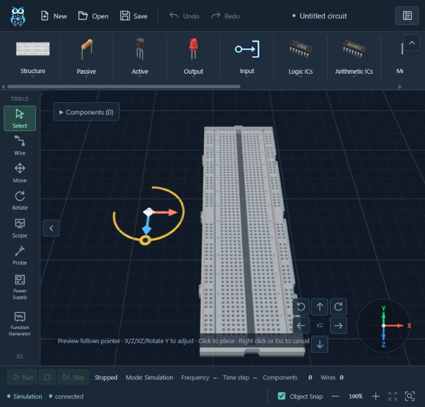
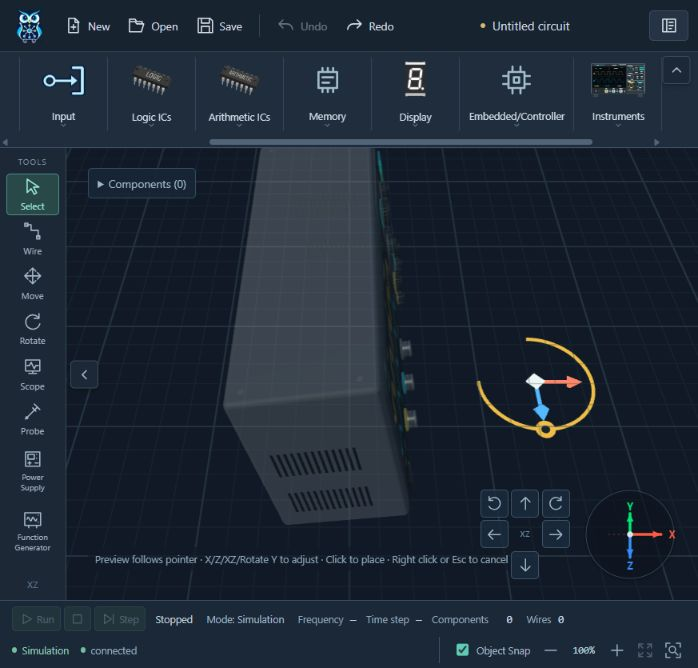
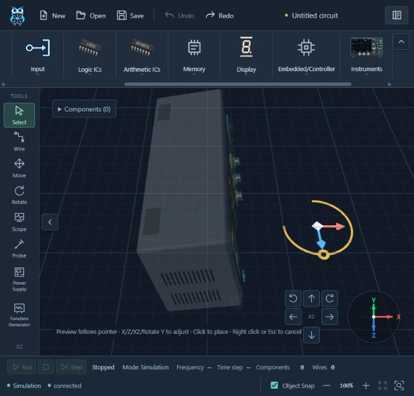
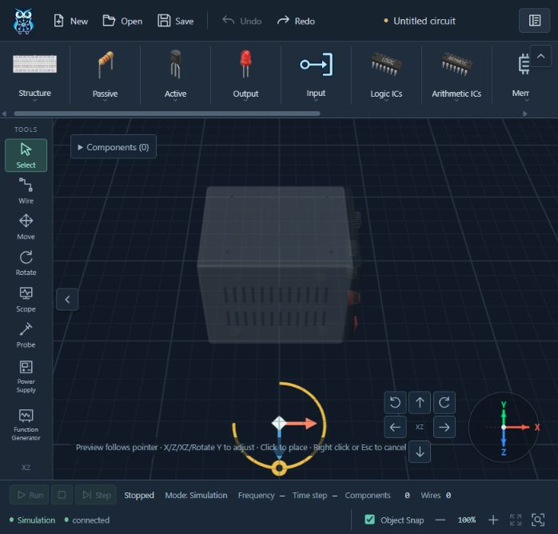
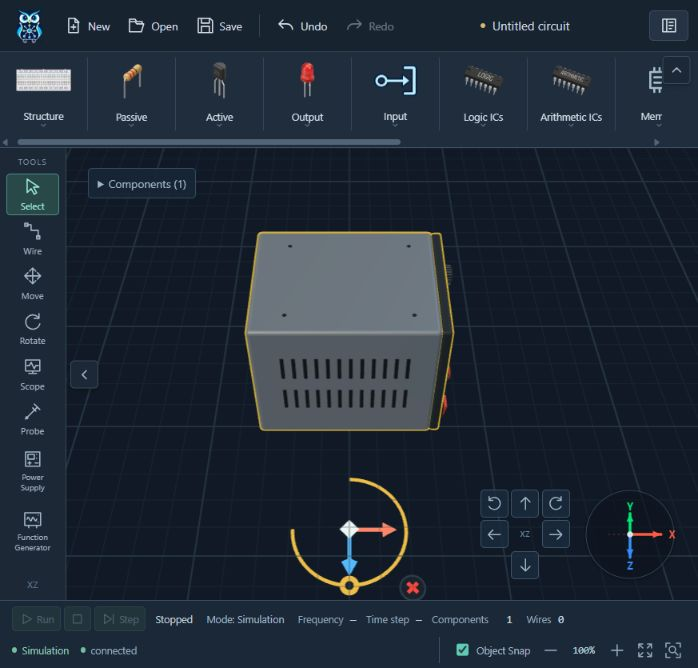

# Placement cursor follow — 2026-10-12

Baseline: `d6dbbc4`. The current request supersedes the placement-body-drag interaction. Earlier anchored-ghost reports and body-drag screenshots are historical records.

## Source analysis and behavior

`useCircuitEditor.ts` already owns the local PlacementDraft and captured transform gestures. The body-drag implementation stopped ordinary placement movement after the first draft, added a placement-only MoveGesture target/raycast and exposed hoveredPlacement. `ComponentTransformGizmo.ts` hid both XZ and Delete for placement. `CircuitWorkspace3D.vue` used that body-hover state for the cursor/help text. Those paths prevented the original no-button placement workflow.

The editor now processes gizmo hover/picking first. Ordinary pointer movement updates only the draft's snapped position and calls setGhost with its existing rotation. X/Z constraints, XZ free movement and rotate-y share the existing captured transform logic. Hover/drag pauses auto-follow; ordinary movement away from the handle or after release resumes it. An outside click confirms the current full pose through the existing atomic placement command. Escape/right click cancels. Preview never creates a graph module, electrical identity, ports, Info or history. After commit, the selected model retains its original five handles, including Delete.

Placement body drag, PlacementPick/pickPlacement and hoveredPlacement are removed. The ghost remains outside the models map and ordinary scene picking. Only Delete is hidden and excluded from placement gizmo raycasting; XZ is restored. Existing yaw-aware snap/docking/anti-overlap and one-step placement Undo/Redo remain unchanged.

A literal follow implementation made an adjacent gizmo chase a gradually approaching pointer. A failing 50-step raycast regression reproduced the problem before the final fix. SceneManager therefore retains a **visual-only gizmo anchor** while the pointer moves, then settles it once after 160 ms idle. The actual ghost continues to follow on every ordinary move; no model/graph pose is frozen by that timer. Hover/activation cancels settlement, and active gestures use the actual ghost pose plus the original locked offset. Ghost replacement/removal and scene disposal cancel pending work. Equal positions schedule no idle redraw. Selected models receive no placement anchor and keep their original layout/gesture behavior.

No new Pinia state, listener, dependency, second gizmo, renderer loop, canvas resize or graph/schema change was introduced.

## Verification

- Full `apps/web` `npm test`: **206/206 PASS**, zero skipped/cancelled, includes test TypeScript checking.
- Full root `PYTHONPATH=.audit-runtime python -m pytest -q`: **97/97 PASS**; three existing dependency deprecation warnings. Final Windows run uses `$env:PYTHONPATH='.audit-runtime'` and reruns outside sandbox after its Python launcher stalls; the successful run exits0.
- `npm run build`: **PASS**, production TypeScript and147 transformed modules. Sandbox realpath EPERM required rerunning the same build outside sandbox; the successful run exits0. Existing Vite chunk-size advisory remains.
- `python scripts/check_context.py` and `git diff --check`: **PASS**.
- Read-only source re-review: no remaining critical/important finding after the gradual-approach correction.

Interaction tests exercise no-button (`buttons:0`) follow with Snap on/off across Breadboard, Oscilloscope, Function Generator and Power Supply; rotation retained after follow; X/Z/XZ/Rotate; only Delete hidden/unpickable; selected full gizmo after commit; 16 gradual handle approaches (four handles × four types); hover lock/resume; graph/history/Redo preserved before commit; foreign pointers/cancel; yaw-aware rotated Breadboard anti-overlap; full-pose one-step Undo/Redo. Scene tests cover unchanged-pose idle deduplication, idle settlement, hover cancellation and disposal cleanup. Obsolete body-drag tests are replaced with the requested follow behavior.

## Native browser checks

The local workbench was tested through native browser pointer input and normal UI controls. Pointer movement preceding middle-click input occurs without a held left button; ordinary `buttons:0` behavior is also verified directly in the interaction suite. No middle drag was used, so the camera did not pan.

All four models visibly move to successive cursor positions, rotate through the Y handle, then continue following with the changed orientation. Preview screenshots show Components0, Undo disabled, no Component Info, and X/Z/XZ/Rotate with no Delete. Native Breadboard confirmation produces Components1; one Undo returns to0, and one Redo restores the same rotated pose. Native Supply confirmation selects the real model and shows Delete again. Escape cancels the instrument ghosts. Runtime warning/error logs are empty. Canvas dimensions remain698.4×548.2 CSS pixels with872×685 drawing buffer throughout the checks.

## Files changed

Runtime:

- `apps/web/src/composables/useCircuitEditor.ts`
- `apps/web/src/three/SceneManager.ts`
- `apps/web/src/three/ComponentTransformGizmo.ts`
- `apps/web/src/components/workbench/CircuitWorkspace3D.vue`

Tests:

- `apps/web/tests/interaction.test.ts`
- `apps/web/tests/scene.test.ts`

Current documentation: `apps/web/README.md`, `docs/ARCHITECTURE.md`, `docs/CONTEXT.md`, `docs/ROADMAP.md`, `docs/DEV_LOG.md`, `docs/CHANGELOG.md`, this report and its five screenshots. Historical verification files are retained. No commit/push/deployment was performed.
