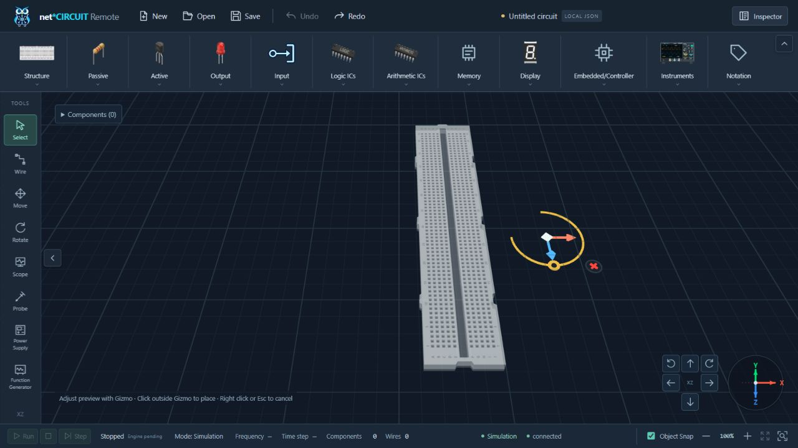

# Placement ghost Gizmo — 2026-10-12

Baseline: `8c4b80d` (`update`). No dependency, schema, Circuit Graph architecture, instrument/window manager, drawer animation or gizmo geometry changes.

## Source analysis and ownership

- `useCircuitEditor`: placement previously committed before `pickGizmo`; regular mouse movement rewrote the ghost pose. Transform gestures already provide captured X/Z/XZ and unwrapped Y-angle math, visual preview and one command on release.
- `SceneManager`: one gizmo previously targeted only highlighted models. Ghost was a separately owned scene object, absent from graph reconciliation, electrical endpoint lookup and ordinary model picking. Its position-only update already reused geometry.
- `ComponentTransformGizmo`: adaptive pixel scale, model/neighbor/viewport/DOM obstacle scoring and locked drag offset can operate on the ghost's existing visual bounds without modification.
- `workspace`: existing placement type and selection/tool cancellation remain authoritative; no additional Pinia placement state.
- `circuit`: one command validates and records a graph snapshot. Extending placement's optional initial rotation preserves schema1.0 and existing two-argument callers.
- `ComponentModel`: existing applyPose/build/disposal supports render-only ghost poses; no change required.

## Final behavior

The first valid preview position anchors a temporary `{ type, position, rotation }`. Anchoring lets the mouse reach adjacent handles without the ghost/gizmo chasing it. Ghost is not selected and does not open Component Info. X/Z/XZ/Y drags affect only that pose/geometry; release retains it. Ordinary mouse movement/leave, camera navigation and drawer toggles retain it. Clicking outside the gizmo confirms the draft; clicking before any preview exists still places at the click point.

One gizmo targets the ghost while present and returns to selected-model behavior after commit. Render-only PLACE is never added to Circuit Graph, the scene's models map or port lookup. Delete on ghost cancels placement rather than invoking removeModule. Escape/right click cancel completely. Tool/type/graph changes and owned capture interruption discard stale drafts; foreign move/up/pointercancel/lost-capture cannot release a primary drag.

`placeModule(type, position, rotation = 0)` validates finite yaw and commits normalized rotation and position in one command. The real model is selected after commit; one Undo removes the placement and one Redo restores its full pose.

Draft Breadboard snap/docking/anti-overlap uses explicit rotation, including90°/180°. Axis drags only dock/push along the requested axis and preserve the transverse coordinate; placed-model paths retain their prior behavior. Rotation re-snaps from gesture.initial, so angle reversal cannot accumulate docking drift.

No extra gizmo, timer, event listener, render loop, canvas, renderer resizing or camera mutation is introduced. Stable hover skips redundant ground projection; releasing a draft skips graph sync and duplicate ghost pose application. Scene's existing RAF coalesces visual updates. Placement help clears the Tools overlay with the existing drawer inset.

## Verification

- Frontend: **200/200** tests; test TypeScript included. Nine new tests exercise production raycasting/scene/editor/Pinia/history, replacing only DOM/GPU boundaries.
- RED/GREEN: initial six tests fail against baseline; subsequent drift, constrained-axis overlap and foreign pointercancel regressions reproduce before each fix. Existing191 tests continue passing.
- New coverage: full ghost handles, incremental mouse approach, pose persistence, X/Z/XZ/Y, cancellation, pointer ownership, no graph/history/ports/Info before commit, atomic Undo/Redo, rotation validation and rotated Breadboard docking/anti-overlap without cumulative drift.
- Python/static suite: **97/97**, three existing deprecation warnings.
- Production build: **147 modules**, success; existing large-bundle advisory remains.
- Independent read-only review identifies constrained-axis anti-overlap and pointercancel ownership; both fixes and tests are checked before handoff.
- Native browser: ghost Breadboard has all five handles; X drag and Y rotation retain Components0, disabled Undo and absent Info. Moving the mouse away retains pose. Click outside commits one model and opens Info. One Undo returns to0 and Redo restores its translated/rotated pose. Canvas CSS1280×629 and buffer1600×786 remain unchanged before/after ghost manipulation.
- Native cancellation checks: ghost Delete, Escape and right click each remove the preview with Components0, Undo disabled and the existing Redo branch still available. Collapse/reopen both drawers preserves the ghost pose and canvas dimensions. Placement help clears the Tools drawer. Runtime warn/error logs are empty. Temporary browser tab and Vite session are closed after verification.
- Final `context-check` and `git diff --check` pass. Existing Vite bundle advisory and three Python deprecations are retained; no new runtime warning/error is observed.

## Files changed

- `apps/web/src/composables/useCircuitEditor.ts`
- `apps/web/src/three/SceneManager.ts`
- `apps/web/src/stores/circuit.ts`
- `apps/web/src/components/workbench/CircuitWorkspace3D.vue`
- `apps/web/src/style.css`
- `apps/web/tests/interaction.test.ts`
- `apps/web/tests/editor.test.ts`
- `apps/web/README.md`
- `docs/ARCHITECTURE.md`
- `docs/CHANGELOG.md`
- `docs/CONTEXT.md`
- `docs/DEV_LOG.md`
- `docs/ROADMAP.md`
- this report and the native browser screenshot.
