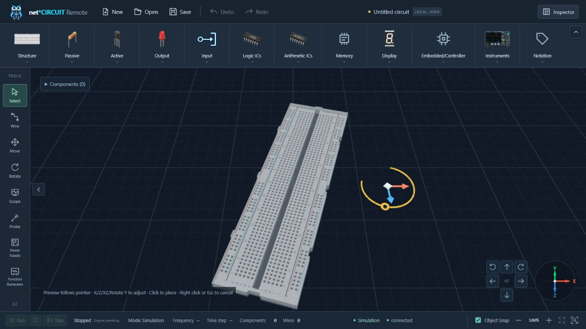
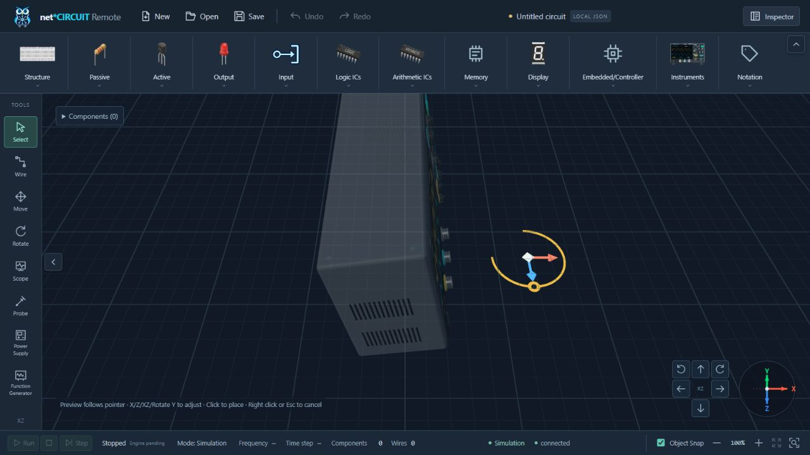
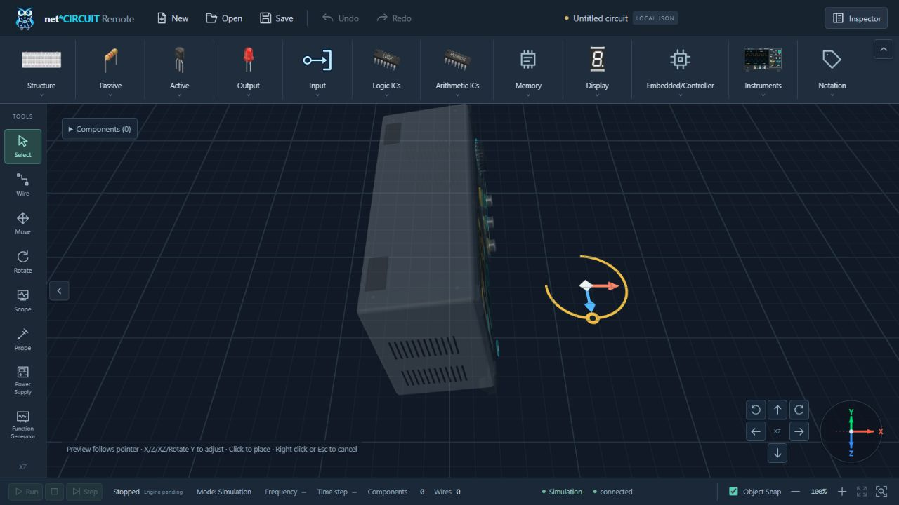
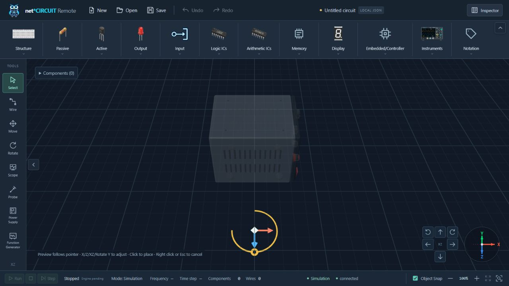
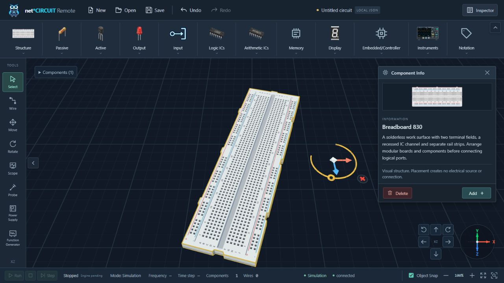

# Unified placement pose and sticky Gizmo — 2026-10-12

Baseline: `1d1688d`. This task replaces the visual anchor/idle settlement described in the earlier placement-follow report. Historical reports and screenshots are retained.

## Source analysis and implementation

`useCircuitEditor.ts` already owns a local, rotation-aware PlacementDraft, pointer capture and atomic pose placement. `SceneManager.ts` previously moved the ghost immediately but supplied a separate placementGizmoAnchor to the Gizmo, settling that anchor through a160 ms timer. `ComponentTransformGizmo.ts` solved16 candidates during update calls from pose, picking and rendering. Those independent positions and repeated solves caused delayed follow and layout jumps.

The anchor and timer are removed. setGhost applies the ghost pose and updates the existing Gizmo immediately, then requests the existing coalesced RAF. No new renderer loop, timer, Pinia state, event listener or dependency is added. The ghost remains render-only, outside models/ports/Circuit Graph/history.

Placement layout caches its relative position offset, candidate index/directions, eight local visual-bounds corners, camera/projection snapshots, viewport, yaw, obstacle identity and graph revision. Ordinary follow translates the Gizmo with the ghost and validates a conservative screen/world free cell, projected model clearance and adaptive scale. Work is constant with respect to model/obstacle count; it does not iterate neighbors or rerun candidate layout. Full solving is reserved for invalid clearance/scale or changed layout dependencies. The existing selected-model layout and transform math remain intact.

Candidates remain sticky under score differences below1500. Invalid current candidates yield to clear alternatives independently of this threshold. Camera changes recompute directions; pose-only updates retain them. Pixel scaling continues to adapt, and model bounds, neighboring models, floating windows, drawer safe areas and viewport edges retain clearance.

Spatial capture uses26 CSS px entry and42 px exit zones around X/Z stems, the XZ center and the actual visible Rotate Y arc. A purely moving hit zone would chase a slowly approaching cursor. A directed approach therefore captures a spatial corridor after4 px of progress toward a handle, with direction alignment0.995 and individual steps up to12 px. This uses pointer displacement, with no idle delay or pose anchor. Leaving the corridor/exit zone resumes follow. Capture/approach state resets at placement transform start/release, dependency changes, pointer leave, replacement/removal and disposal. Gizmo picking/capture precedes auto-follow and commit.

X/Z/XZ/Rotate Y remain visible/pickable; only Delete is hidden in preview. Draft snapping retains rotation, docking/anti-overlap and axis constraints. Preview edits no graph/history; outside click commits the full pose once, with one-step Undo/Redo. Escape/right click cancels. Selected models retain all five handles and existing behavior.

## Verification

- Full `apps/web` `npm test`: **213/213 PASS**, zero failed/skipped/cancelled; includes test TypeScript checking.
- Full root `$env:PYTHONPATH='.audit-runtime'; python -m pytest -q`: **97/97 PASS**, three existing dependency deprecation warnings.
- `apps/web` `npm run build`: **PASS**, production TypeScript and147 transformed modules. Existing Vite bundle-size advisory remains.
- `python scripts/check_context.py` and `git diff --check`: **PASS**. Runtime anchor/timer references are absent from the editor, SceneManager and Gizmo.
- Independent final read-only review: no remaining Critical/Important finding.

Failing tests preceded implementation and the review corrections. Regressions cover same-frame model/Gizmo follow,100 pose updates with stable offset and no layout-bound reads, repeated picking/render queries, continuous rapid no-button movement on all four models, small-score stability, camera/viewport/yaw/obstacle invalidation, model/neighbor clearance, all20 gradual approaches across five types/four handles, physical hover/freeze/resume and boundary hysteresis, visible Y arc vs missing quadrant, and stale capture cleanup after X/XZ translation. Existing pointer ownership/cancel, graph/history immutability, rotated Breadboard snap, full-pose atomic Undo/Redo and selected-model behavior tests pass.

Review found slow-approach chasing, projected model clearance during cached follow, an invalid neighbor candidate retained below hysteresis and an old approach corridor surviving translation. Each was reproduced by a RED test and corrected before the final run.

## Native browser checks

Normal UI controls and native browser pointer input verify Breadboard, Oscilloscope, Function Generator and Power Supply. Pointer movement preceding middle-click occurs without a held left button; no middle drag was used. All four visibly follow successive cursor positions with the Gizmo attached, freeze near the X handle, rotate through the Y grip and resume follow with retained yaw. The unit interaction suite additionally checks gradual approach and all handle constraints with the real raycast/editor math.

Preview screenshots show Components0, Undo disabled, no Component Info and four handles without Delete. Breadboard confirmation creates one component, preserves the pose and restores Delete. One Undo returns Components0; one Redo restores the same rotated pose. Canvas dimensions remain1280×629 CSS pixels /1600×786 drawing buffer. Runtime warning/error logs are empty.

## Files changed

Runtime:

- `apps/web/src/composables/useCircuitEditor.ts`
- `apps/web/src/three/SceneManager.ts`
- `apps/web/src/three/ComponentTransformGizmo.ts`

Tests:

- `apps/web/tests/interaction.test.ts`
- `apps/web/tests/scene.test.ts`

Current documentation: `apps/web/README.md`, `docs/ARCHITECTURE.md`, `docs/CONTEXT.md`, `docs/ROADMAP.md`, `docs/DEV_LOG.md`, `docs/CHANGELOG.md`, this report and its five screenshots. No commit/push/deployment, graph/schema change, UI artwork change or instrument/drawer refactor occurred.
