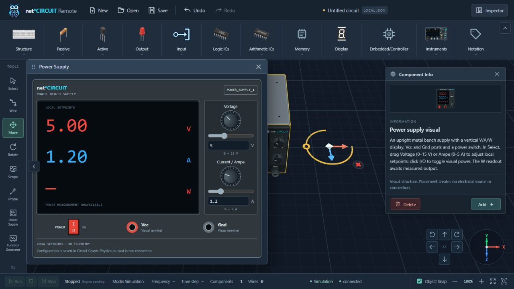
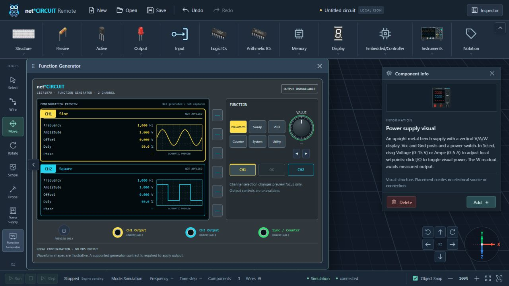

# Supply / Generator launchers and GUI — 2026-10-12

Baseline: `a9b7656`. Local verification; hardware output/acquisition remains unavailable.

## Source analysis and implementation

Read ToolRail, workspace store, FloatingWindow/manager, window definitions, instrument store, WorkbenchIcon, PowerSupplyModel, FunctionGeneratorModel/Artwork, GeneratorWindow and instrument CSS. Also inspected CircuitStore property validation/history, canonical catalog, existing supply gesture handling, keyboard/gizmo deletion, drawer lifecycle and related tests/docs.

ToolRail previously exposed Delete and changed workspace.tool for every entry. The new Supply/Generator entries call ui.openWindow directly, preserving all workspace state. Delete is removed only from the sidebar list; its workspace type, editor branches, Delete/Backspace and selection gizmo remain. Dedicated local stroke SVG paths fit the66/54 px rail; two-line labels and existing toolbar scrolling keep launchers reachable at short heights.

Power supply controls already use canonical voltage_v/current_limit_a/power_on and validated CircuitStore commands. The new window derives only the selected POWER_SUPPLY, reuses model value/limit helpers and commits through updateModuleProperties. Native range/number changes commit once per completed drag; switch clicks commit one power toggle. Invalid edits report validation errors and restore the canonical input value. No setpoint copy, supply state in instrument store, event stream or telemetry is added. Selection changes, deletion and history restoration naturally update the computed binding. V/A display local setpoints while ON; OFF retains graph configuration. W remains unknown. Visual Vcc/Gnd do not create graph ports.

GeneratorWindow consumes shared GENERATOR_LAYOUT key/arrow/soft-key/output metadata, channel/Sync colors, parameter labels and theme from Artwork. Static normalized waveform shapes are explicitly schematic previews, without time/sample/telemetry claims. All function/encoder/soft-key/power/output controls remain disabled; enabled CH1/CH2 buttons only change a window-local visual focus. Existing flat generator fields remain CH1 configuration; nested channel2 holds independent local defaults. Phase remains unknown. Amplitude retains the existing V configuration unit; no Vpp conversion/output semantics are invented. Shared model/artwork theme substitutions keep original values and geometry unchanged; generated GLB/PNG/SVG assets are untouched.

Default Supply600×510 and Generator760×530 use the existing window manager and responsive clamp/scroll behavior. Scoped container queries stack panels at small widths and use a two-column narrow keypad. Existing Scope/Monitor components, ui/workspace/Circuit stores, graph contracts, scene/renderer/camera and drawer animation are unchanged. InstrumentDial only adds an optional unavailable-reason tooltip with the previous Scope default retained. Obsolete global Generator CSS was removed; other instrument selectors remain.

## Verification

| Check | Evidence |
| --- | --- |
| Red/green | Five feature tests failed before implementation: Delete still present, missing Supply window/default and missing two-channel Generator layout. The new Delete/Backspace regression passed on the existing editor. |
| `cd apps/web; npm test` |191/191 PASS, including test TypeScript and existing graph/geometry/resource/history/window/drawer/camera/transport tests. |
| `cd apps/web; npm run build` |Production TypeScript/build PASS,147 modules; existing large-chunk advisory remains. |
| `$env:PYTHONPATH='.audit-runtime'; python -m pytest -q` |97/97 PASS, three existing dependency deprecations. |
| Launcher tests |Actual compiled ToolRail events preserve the complete workspace state and graph for Select/Wire/Move/Rotate, including pending port/selection/area mode; unique window reuse/activation, distinct icons and absence of sidebar Delete are asserted. Media listener is released on unmount. |
| Supply tests |Actual compiled controls write canonical voltage/current/power, one history commit per change, Undo/Redo reflects inputs, multiple selections stay independent, deletion/non-supply/empty selection disable binding, invalid16 V edit cannot mutate graph/history, instrument state is unchanged and W is unknown. |
| Generator tests |Actual compiled layout/spec colors/control labels, independent CH2 config and readable legacy CH1 fields, local focus selection without graph/instrument mutation, no canvas and disabled output controls are asserted. |
| Native browser launchers |Move remains active while Supply and Generator launch. Delete button is absent from sidebar; existing selection actions remain. |
| Native browser supply |Placed source through real Inspector/catalog, set5 V/1.2 A using native number-key edits, toggled POWER, verified window values and Undo/Redo. Native canvas Delete removes the supply and immediately shows NO SUPPLY SELECTED/disabled controls. Undo restores its graph model without implicitly selecting it. |
| Default desktop bodies |Supply body client/scroll height472/472 and width598/598; Generator492/492 and758/758. All footer content fits. |
| Responsive320×480 |Both bodies have client/scroll width254/254 and document width320. Existing vertical scrolling remains. Generator narrow keys were measured overflowing before correction; final six keys each have equal client/scroll width58 px. Rail auto-scroll keeps the launcher buttons accessible. |
| Scope / Monitor regression |Scope retains seven disabled dials and NO CAPTURE SOURCE. Monitor retains NO TRACE DATA. One workspace canvas only. |
| Drawer / viewport regression |With Monitor open, both collapse and reopen preserve window162/181 px and canvas1280×629 CSS /1600×786 buffer dimensions. |
| Review / console |Read-only independent review found no critical/important source/test finding. Browser warning/error logs empty. |

Test host renders production SFC event handlers with existing Vue/esbuild; it substitutes only DOM/GPU boundaries. Browser QA uses the real application; no production probe or launcher fixture is introduced. Commands use approved external execution because this Windows sandbox restricts runtime/loopback access. Temporary viewport override is reset, browser tab closed and owned Vite server stopped after QA.

## Files changed

Production:

- `apps/web/src/components/workbench/ToolRail.vue`
- `apps/web/src/components/workbench/WorkbenchIcon.vue`
- `apps/web/src/components/windows/FloatingWindowManager.vue` (register Supply only)
- `apps/web/src/components/windows/PowerSupplyWindow.vue` (new)
- `apps/web/src/components/windows/GeneratorWindow.vue`
- `apps/web/src/components/windows/InstrumentDial.vue`
- `apps/web/src/types/windows.ts`
- `apps/web/src/stores/instrument.ts`
- `apps/web/src/data/instrumentVisuals.ts`
- `apps/web/src/three/PowerSupplyModel.ts` (identical shared colors)
- `apps/web/src/three/FunctionGeneratorArtwork.ts` (shared labels/theme)
- `apps/web/src/three/FunctionGeneratorModel.ts` (identical shared colors)
- `apps/web/src/style.css` (obsolete Generator selectors)

Tests:

- `apps/web/tests/instrument-launchers.test.ts` (new)
- `apps/web/tests/helpers/vueSfc.ts` (new)
- `apps/web/tests/interaction.test.ts`
- `apps/web/tests/instrument-windows.test.ts`

Documentation: CONTEXT, ARCHITECTURE, ROADMAP, DEV_LOG, CHANGELOG, web README, this report and the two screenshots below.

## Screenshots

Selected source displaying local setpoints and unknown W; Move remains active:

Two-channel Generator configuration preview with unavailable output; Move remains active:

