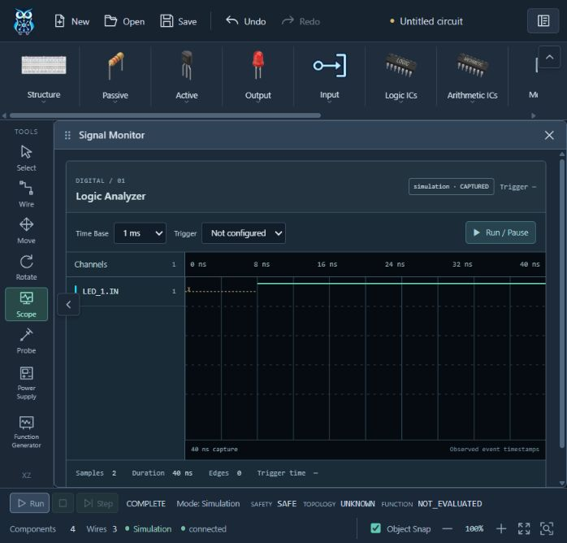
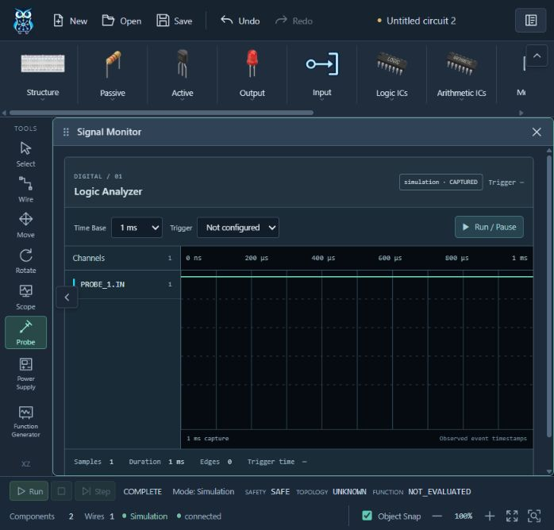

# Lab-First R6 verification — 2026-10-13

Branch refactor, phase subject `refactor(r6): integrate Lab-First frontend execution`.

- Canonical generated TS/types and runtime schema snapshot checked against Lab 1.0. Same nested parser for HTTP and websocket records; stale revisions rejected. Public capabilities omit low-level routing node maps.
- Full Python: 180 PASS. Frontend: 225 PASS. Context and snapshot checks PASS. Build: 152 modules, 937 kB class JS, PASS; known non-blocking >500 kB chunk advisory. Three existing Python dependency deprecations.
- Independent read-only reviewer reproduced eight defects; all fixed with RED→GREEN regressions, independently rechecked with 42 Python and 12 frontend tests. Migration ledger records dependency repairs and their costs.
- Browser used isolated localhost helpers: Vite15173 → API18000 → Hardware RPC15051 → actual process worker. Built two true switches → 74HC08 AND → LED using existing Inspector and logical wiring controls. COMPLETE, SAFETY SAFE, TOPOLOGY UNKNOWN, FUNCTION NOT_EVALUATED (no assignment). Four components/three wires retained. Observed LED X@0 then1@8ns; 40ns capture, no fabricated analog data.
- Scope stays empty/no capture; Generator CH1/CH2 stays preview/unavailable; trigger/step disabled. New session and subsequent changed draft (switch → PROBE) completes with PROBE_1.IN capture, without inheriting LED_1.IN from the previous capture. Browser warning/error logs empty.
- Store state changes during development HMR required one clean reload; fresh session and repeated draft runs verified afterward. This is development state replacement, not a production build result.
- Original 213 editor/layout/placement/history/viewport/model tests retained; Run tests assert immutable graph/history. No extra render loop, WebGL canvas or model rewrite.

Hardware is unavailable without an actual driver/profile. Tests using protected-driver fixtures prove software guard behavior only. Production PostgreSQL, real electrical scanning/ADC/DAC/SDRAM and physical load remain unverified target deployment work.

