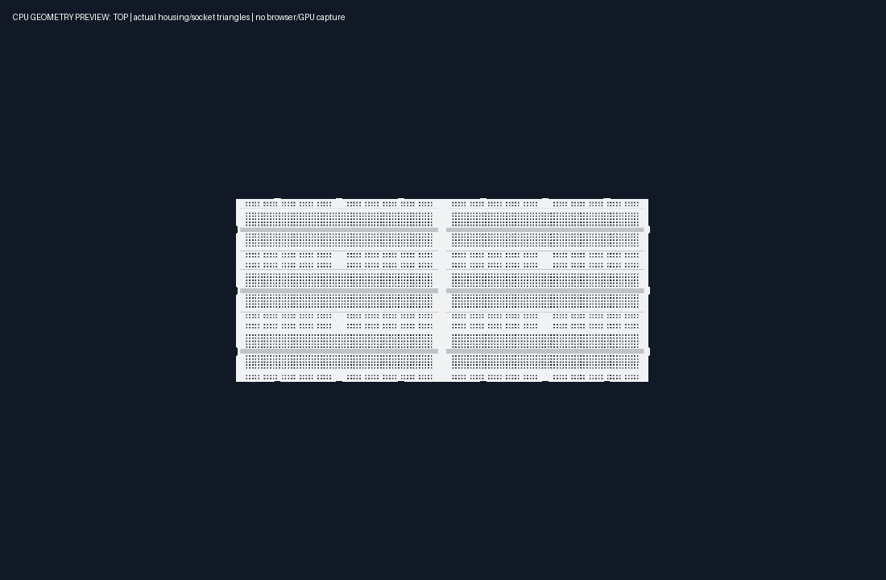
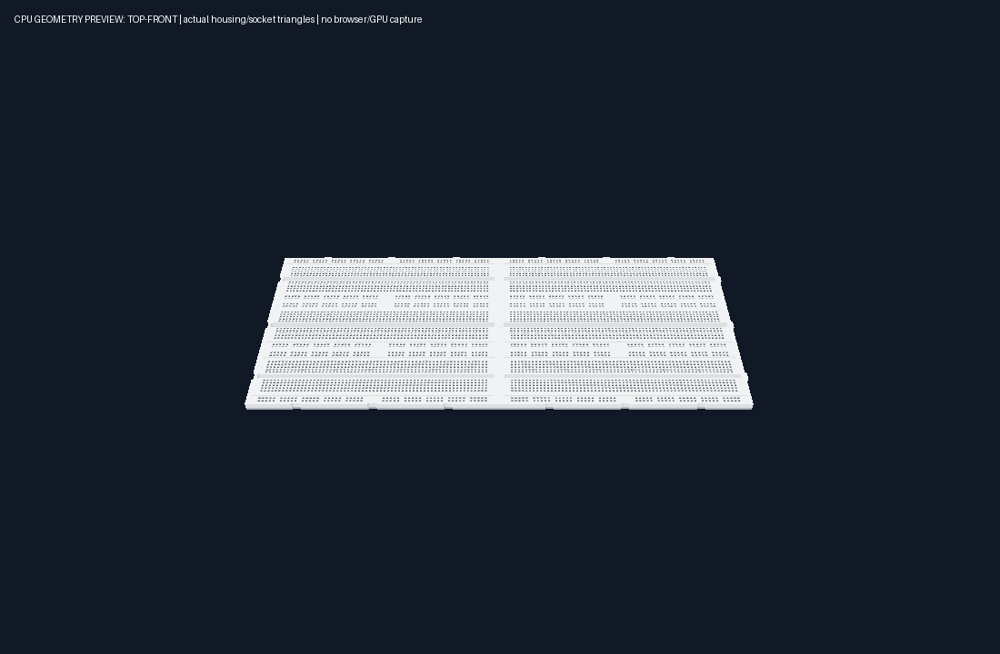

# Breadboard mechanical docking — 2026-10-14

Implemented against the current working tree at `9543582`, preserving the approved camera-relative placement change. Catalog dimensions, contact positions/IDs/nodes, sockets, wire routing and CircuitGraph remain unchanged.

## Shared geometry and mating rules

`apps/web/src/geometry/BreadboardGeometrySpec.ts` supplies housing contour, nominal dimensions from editorCatalog, extrusion levels, bevel/seam compensation and four local side profiles. NORTH is local -Z, SOUTH +Z, EAST +X, WEST -X. NORTH/EAST have male joints; SOUTH/WEST have corresponding female slots. Long strip sides share three keys; end sides share one key. Female clearance is 0.0015 editor-world units. The mating planes of straight plastic edges coincide; clearance exists inside the slots. Bevel inset 0.008 minus shared visual seam compensation 0.0075 leaves a 0.0005 top-edge inset per housing. Existing overall dimensions and socket/deck heights are preserved.

`breadboardDocking.ts` transforms each side's plane, normal and keys through both world poses. Only opposing compatible joint families can magnetically mate; there is no automatic yaw change. Mixed 830/630/100 sizes use their actual side planes. Relative orientations with incompatible male/female or strip/end joints are safely separated rather than treated as a dock. Axis handles keep their transverse coordinate while reaching the rotated mating plane.

The real concave contour is triangulated once per geometry profile. World contours are cached by module identity and pose signature; triangles are built only after broad-phase overlap. AABB is an early-out, never the mechanical mating rule. Capture filtering precedes candidate geometry creation; collision fallback includes other boards and an escape outside occupied projections. Exact mating coordinates are retained after docking; ordinary workspace snapping keeps its existing rounding. The internal `docked` flag is omitted before a pose reaches CircuitGraph.

## Tests and evidence

- Original production-mesh measurements: straight body gap approximately zero at Y=0.2, but top bevel gap **0.014** at Y=0.327. An incorrectly AABB-docked quarter-turn board penetrated a mismatched joint by **0.0065**. New geometry tests failed on both cases before implementation.
- Final `npm.cmd test`: **327 passed, 0 failed**, including type-check, existing interaction/camera-facing placement/history/file/wire/topology/scene tests.
- New `breadboard-docking.test.ts` raycasts actual housing meshes for all four sides, all three variants and mixed pairs at 0/90/180/270 degrees. Straight surfaces have gap between -0.000002 numerical mesh tolerance and 0.002; samples along keys stay below 0.006 with no penetration beyond that numerical tolerance.
- A six-board 2-column × 3-row fixture checks every horizontal/vertical seam and exact row/column spacing without accumulated drift. TOP and two oblique camera views project real seam edges to less than 0.15 CSS pixel at the tested viewport.
- Tests cover 37-degree mixed-size docking, third-board obstruction, locked-axis precision, fractional imported positions, full-turn placement without drift, in-place pose/type cache invalidation and atomic commit/Undo/Redo. Updated old AABB/large-clearance assertions now exercise actual housing collision and compatibility.
- Fresh independent review found eager distant-candidate geometry and rounding-induced penetration. Both were reproduced RED→GREEN; the precision fix also covers a constrained rotated axis. No second review was dispatched. The CPU regression fixture reports **42.18 ms** before the optimization and **1.71 ms** after it for median far pointer-follow over 500 settled boards on this host; this is CPU timing, not GPU FPS.
- Production Vite API build passes with invocation-only `resolve.preserveSymlinks=true`, the existing sandbox adapter; repository configuration is unchanged. Existing large-chunk advisory remains. Topology snapshot check, context check and `git diff --check` pass.

Full logs/probes are retained in `.superpowers/breadboard-docking/` (`red.log`, `profiles.log`, `review-red.log`, `review-green.log`, `final-frontend.log`, `final-build.log`).

## Visual inspection and limits

The following previews rasterize the actual housing/socket triangles exported from SceneManager using a CPU depth buffer. TOP and oblique previews were visually inspected: the cluster joins without the wide dark spaces between straight board edges. Canvas artwork, application GUI and GPU shading are not reproduced. These are clearly labelled geometry previews, not browser screenshots.

Earlier browser permission denial was honored; no alternate browser or UI workaround was used. Native browser appearance/input and GPU FPS remain unverified. The editor profiles use existing arbitrary world units; no physical manufacturing-fit certification is claimed. Direct nonfinite helper inputs are outside these tests; production graph/file/store validation continues rejecting them. Source remains reviewable in refactor without commit/merge/push.
