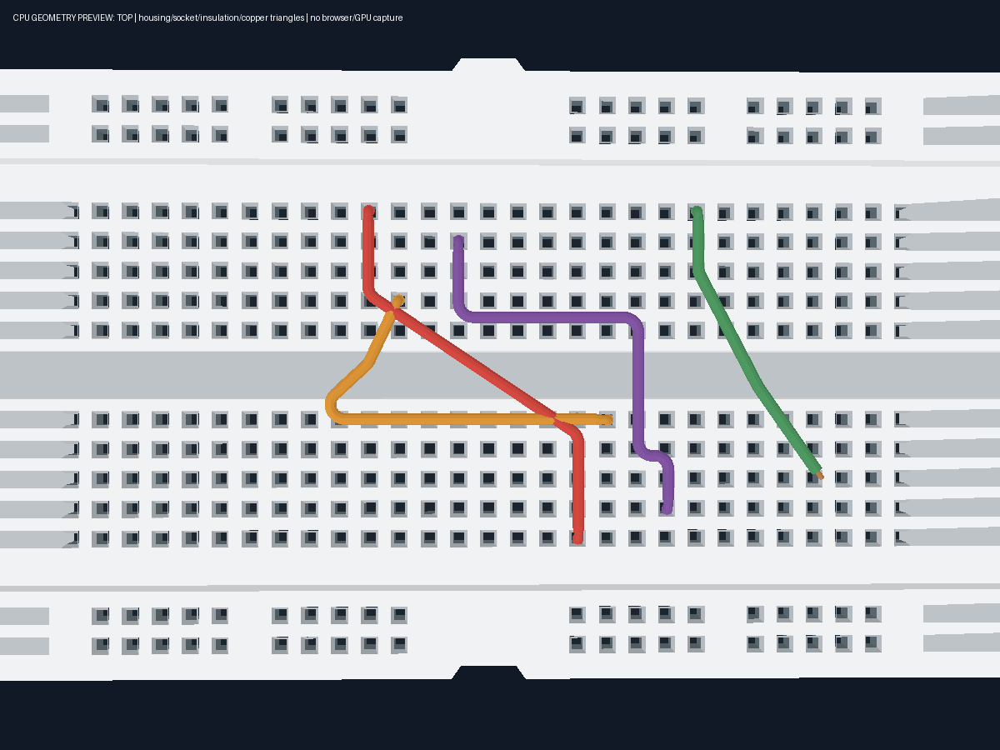
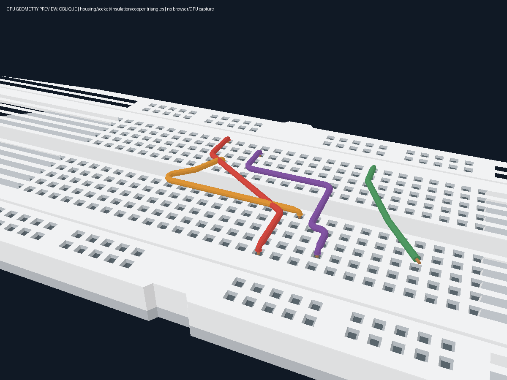

# Wire path, copper terminals và routing UX — 2026-10-14

Thực thi brief `e75ec390/Pasted text.txt` trên working tree sạch tại HEAD `0d742c1`. Phạm vi frontend/Three.js Wire; báo cáo này mô tả workflow hiện hành sau refactor. Zoom, pan XZ, đường kính cấu hình, model geometry, CircuitGraph schema và electrical resolver giữ nguyên.

## Root cause

- `materializeWireRoute()` trước đây sao chép cả các elbow do solver sinh vào `controlPoints`. Handle/edit index trộn lẫn user anchors với generated points; những lần solve/edit tiếp theo tiếp tục chèn elbow, dẫn đến số điểm tăng và route tự gập.
- RMB chỉ append point, không có trạng thái provisional/reversible. Default UI Auto khiến jumper trên board thường bị ép thành đường X/Z dù người dùng muốn vẽ chéo.
- Renderer sweep insulation qua cả lead xuống socket, không có metal core và cap. Sharp frame changes ở đoạn rất ngắn có thể làm mặt ống đảo vào trong; so sánh tọa độ exact khi chọn thứ tự elbow có thể đổi route sau khi board rotate.

## Kiến trúc mới

```text
CircuitGraph connection: source + destination
                  │ resolve named endpoint positions
WireVisual v1: color / mode / USER anchors / thickness / height / layer
                  │ solveWireRoute (không mutate graph/visual)
SolvedWireRoute: semantic points + stable user handles + segment spans
                  │ deriveWireParts
Insulated body + two shared-resource copper terminal meshes
```

`semanticPoints` phân biệt `ENDPOINT`, `TERMINAL_LEAD`, `USER_ANCHOR`, `GENERATED_ELBOW`. Handle `index` luôn là index trong persistent `controlPoints`; segment giữ `beforeUserIndex`, `afterUserIndex`, `insertIndex`. Generated points phục vụ route/render, không được lưu thành electrical endpoint hoặc visual anchor. Compatibility shim `materializeWireRoute()` chỉ copy visual và giữ routing frame.

FREE nối thẳng endpoint leads → user anchors → endpoint leads, giữ diagonal, zig-zag và crossings có chủ ý. ORTHOGONAL/AUTO trên board sinh elbow trong frame của board; canonical order dùng cùng epsilon với axis equality, nên reversal và rigid Move/Rotate không đổi hình dạng route. UI new-wire default là FREE; fallback/legacy `defaultWireVisual()` vẫn AUTO. Saved v1 giữ những điểm đã lưu; metadata cũ không có provenance để tự phân biệt một điểm từng là user hay generated, vì vậy không tự xóa/migrate các điểm đó.

Move bend dùng user index; double-click insert đúng span; Delete chỉ xóa user anchor đã chọn. Segment drag chỉnh user boundaries lân cận. Bare route chưa có anchor seed hai support anchors một lần; những lần kéo sát pin sau đó tái sử dụng boundary thay vì append liên tục. Span có một pin cố định reshape/pivot quanh pin; ở ORTHOGONAL một leg trực tiếp nối pin có thể giữ vị trí trong khi leg kế tiếp thay đổi. Hai user boundaries có thể dịch cùng nhau; ORTHOGONAL constrain delta perpendicular trong frame của board.

Normalization reject NaN/Infinity và collapse consecutive near-duplicate anchors cùng owner. Những explicit collinear handles/crossings giữ được để người dùng sửa; renderer loại redundant near-collinear samples riêng, gồm góc dưới khoảng .0006° để tránh arc nhỏ hơn Float32 precision. Không sửa connectivity. Preview chỉ đổi local scene data; release hợp lệ mới ghi một history command. Stale/cancelled/unchanged gestures không ghi thêm history.

## Render và UX

`WireTerminals.ts` derives hai capped copper cylinders từ exact route endpoints, radius nhỏ hơn insulation. Material copper/brass metallic; phần lõi lộ ra ở socket, nhúng ngắn vào cap ring để kín transition. Body bắt đầu/kết thúc tại junction phía trên socket. Cylinder geometry/material dùng chung trong layer; xóa một wire chỉ detach pins, dispose shared resource một lần khi layer kết thúc. Logical ports cũng có derived metal tips mà không thay endpoint.

Preview có source copper và free moving copper ngay khi bắt đầu. Thêm corner không tạo terminal ở bend; free tip tiếp tục ở cursor hoặc endpoint đang hover. Nếu plane bị model chắn, preview giữ cursor hợp lệ cuối thay vì biến mất.

Fillet là cung tròn tangent, radius/trim thích ứng chiều dài từng đoạn, giữ khoảng thẳng giữa hai góc, không CatmullRom/overshoot. Tube frame dùng parallel transport. Góc nhỏ hơn radius của vỏ taper cục bộ để tránh folded faces; đoạn dài vẫn giữ đường kính cấu hình. Intentional near-antiparallel returns dùng hai capped sweeps gặp nhau tại vertex; picking polyline có guard riêng để vẫn finite. Render giữ crossing có chủ ý, không tự giải quyết collision giữa các dây.

Workflow: chọn màu/mode → left endpoint → move → RMB corners → left endpoint commit. `CornerState` là `none` hoặc `provisional` với user index, anchor, screen origin và travel state. RMB cùng snapped location hoặc trước khi di chuyển 4 px undo corner cuối, giữ draft. RMB ở vị trí khác thêm corner tiếp. Esc cancel; Backspace/Delete pop; Alt bypass snap. Browser context menu bị suppress trong draft; right orbit ngoài draft giữ nguyên. WireOptions và accessible workspace help mô tả workflow mới.

Selected user handles dùng instancing, radius khoảng 3.5 CSS px, pick margin 8 px; endpoint indicators màu xanh, bend vàng, hover/selection feedback và segment gold highlight. Không tạo DOM cho wire, không thêm RAF. SceneManager chỉ cập nhật screen-scale handles trên render loop hiện có và đưa copper meshes vào surface picking/Area focus hiện có.

## Files

| Nhóm | Files |
| --- | --- |
| Route semantics/editing | `apps/web/src/wires/wireRouting.ts`, `wireRouteEditing.ts` |
| Body/terminal rendering | `apps/web/src/three/WireGeometry.ts`, `WireLayer.ts`, **`WireTerminals.ts` mới**; `apps/web/src/wires/wireAppearance.ts` |
| Controller/scene | `apps/web/src/composables/useWireRouting.ts`; `apps/web/src/three/SceneManager.ts` |
| UI/default/help | `apps/web/src/stores/workspace.ts`; `apps/web/src/components/workbench/WireOptions.vue`, `CircuitWorkspace3D.vue` |
| Regression tests | `apps/web/tests/wire-routing.test.ts`, `wire-geometry.test.ts`, `wire-interaction.test.ts`, `wire-layer.test.ts`, `wire-options.test.ts`; **`tests/helpers/wireGeometryAssertions.ts` mới** |
| Docs | `apps/web/README.md`, báo cáo này và hai CPU geometry previews |

`wireVisual.ts`, types/schema, circuit store, backend/contracts/simulator/hardware/FPGA không đổi. Đã đọc và giữ coverage các wire tests hiện có, including files/history/legacy visual data.

## Verification

- Final `npm.cmd test`: **359/359 PASS**, zero failed/skipped/cancelled, 25.48 s; bao gồm test typecheck. Baseline 340, thêm 19 regression, giữ coverage cũ.
- Drawing: copper source/free tip, continuous preview qua corners/blocked plane; RMB same-snap và small motion toggle, 4 distinct corners; Esc/Backspace/Delete/contextmenu/orbit gating.
- Route/editor: direct FREE diagonal/custom crossing polyline; render-only ORTHOGONAL elbows; stable user handle/insertion index; color/mode/add/remove; rejected nonfinite/duplicate input. **50 completed bend/interior-segment gestures và 50 endpoint-adjacent segment gestures cho mỗi mode FREE/ORTHOGONAL**, finite/nonzero/nonfold geometry, count bounded, one Undo per release, unchanged endpoints/nets. Save/Open/Undo/Redo/v1 cases tiếp tục PASS.
- Mesh/resources: solid/annular caps, real narrow metallic pins with exact tips, insulation above socket, free pin reuse, screen-sized handles, shared-resource single disposal, color/unchanged buffer reuse. Regression cho .0001/.001-length shallow turns, exact return picking polyline và sub-Float32 collinear corner.
- Existing camera/zoom/pan/placement/Gizmo/ViewCube/Move/Rotate/history/scene/electrical-net tests tiếp tục PASS. Raised-anchor route rigid transform và canonical reversal được kiểm tra.
- Review độc lập read-only đóng toàn bộ findings. Fresh in-memory probes: 130 geometry cases finite/nonzero/nonfold, 100 repeated pin-span drags bounded, 360 integer yaws rigid, return body/hidden-line/copper buffers finite. Không mở browser hoặc chỉnh Git/test output.
- `npm.cmd run build`: typecheck PASS; Vite chuẩn bị chặn bởi **EPERM realpath** tại `apps/web/src/main.ts`, cùng lỗi môi trường ở baseline.
- Production invocation adapter `node --input-type=module -e 'import {build} from "vite"; await build({resolve:{preserveSymlinks:true}});'`: **PASS**, 176 modules, 4.71 s. Không đổi Vite/package config; advisory chunk >500 kB vẫn có.
- CPU probe 300 AUTO wires, 20 warmups +100 samples: dense pick median **4.616 ms**, p95 **5.287 ms**; background median **0.438 ms**, p95 **0.629 ms**. Sync lại giữ cả 300 body geometry và serialized graph; đây là fixture tổng hợp CPU, không phải đo FPS/GPU.
- Final `git diff --check`: PASS. Logs/probes nằm trong ignored `.superpowers/wire-refactor/`.

## Kiểm tra hình học và giới hạn

Đã dựng TOP/OBLIQUE bằng software rasterizer từ actual production housing/socket/body/copper triangles và camera matrices, rồi kiểm tra ảnh. Visible ancestor filtering giữ hidden gizmos ngoài ảnh. FREE diagonal/custom path, ORTHOGONAL elbows, low board routing và preview free tip có trong fixture. Không có browser/WebGL capture, texture labels, PBR reflections, GPU shadow/AA hoặc xác nhận native browser pointer UX; không dùng ảnh CPU để tuyên bố đã QA WebGL.





Tight corners có taper cục bộ; pin-adjacent ORTHOGONAL edits reshape quanh pin cố định. Crossings/returns có chủ ý được giữ, không có collision/rerouting tự động giữa dây. Saved legacy anchors đã materialize từ bản cũ không được tự suy đoán provenance. Build chuẩn còn bị giới hạn realpath của môi trường; browser/GPU appearance/performance chưa xác minh.

## Git

Đã thử ordinary `git add .`, dự kiến commit `feat(web): stabilize jumper paths and render copper terminals`. Staging bị chặn: `Unable to create .../net-Circuit-Remote/.git/worktrees/refactor/index.lock: Permission denied`. Metadata Git của worktree đang read-only trong môi trường; chưa tạo commit. Không dùng alternate index hoặc đổi permissions để vượt giới hạn. Source/tests/docs/previews vẫn trong working tree.

Khi có quyền ghi Git metadata, chạy tại repository:

```powershell
git add .
git commit -m "feat(web): stabilize jumper paths and render copper terminals"
```
