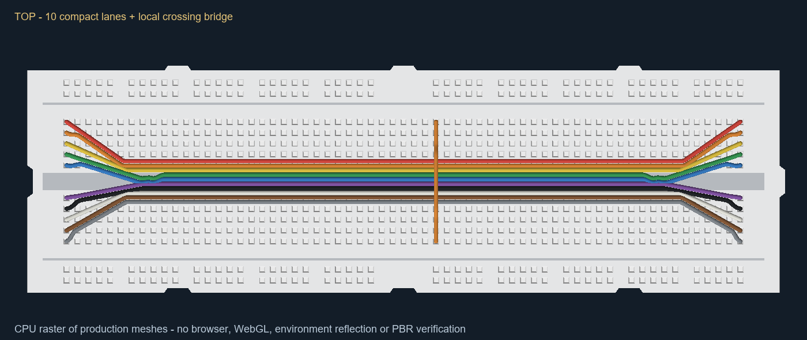
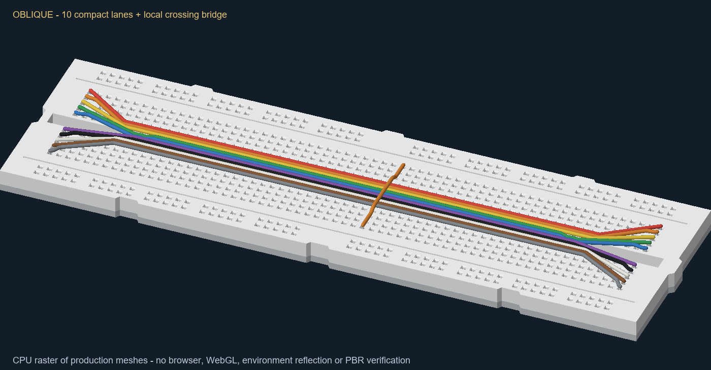
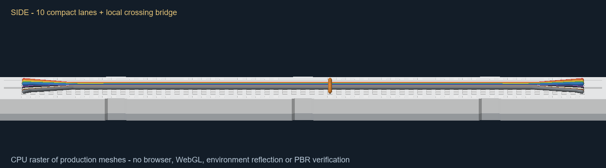

# Compact wire routing and fixed silver terminals

Frontend wire implementation against the supplied `83cc5372-147c-4950-9cb2-c77c68f32d74/Pasted text.txt`, starting at `3ec9879`. The previous global vertical stacking implementation is replaced. CircuitGraph, endpoint identity, electrical nets, file schema, backend, contracts, simulator and hardware are unchanged.

## Root causes

- `deriveWireParts` added `layerOffset` to conductor length, exposing an increasingly long metal stem.
- `solveWireRoute` raised every body/anchor by a scene-wide diameter-based layer step, treating long parallel overlaps and true crossings identically.
- The old physical-height stack solver needed extra layers and cascading occupancy swaps. Those operations were inappropriate for compact side-by-side jumpers.
- A healthy triangle mesh alone cannot establish a healthy route: full-radius outward-facing triangles can still follow a centerline that doubles back. The final review reproduced this on short S bends, as well as missed shallow and sloping intersections.

## Terminal algorithm and appearance

`solveWireRoute` now produces only the semantic base route. Breadboard body center height is `deckHeight + renderedRadius + WIRE_SURFACE_CLEARANCE`; `.004` is the small deck gap. Saved `visual.height` is retained for file compatibility but does not raise the default breadboard route. Explicit user anchor heights remain intact.

For a contact, the insulation collar is based on the deck plus `diameter * TERMINAL_CLEARANCE`, capped by the short `.042` conductor allowance. `TERMINAL_CLEARANCE` is `.4` of diameter. Neither order priority, lateral displacement nor crossing height enters this calculation. Insulation continues down the plugged vertical lead to that fixed collar.

For the usual `.052` wire on the `.33` deck:

| Measurement | Value |
|---|---:|
| Body center base Y | `.36` |
| Collar Y | `.3508` |
| Metal above deck | `.0208` |
| Deep inserted tip Y, for logical contact Y `.309` | `.2466` |
| Separate hidden metal/insulation overlap | at most `.006` |

Insertion remains bounded by diameter and contact pitch, independently of exposure. The core is narrower than the insulation, capped and opaque. Its material is bright silver `#d9dfe5`, metalness `.95`, roughness `.20`, with zero emissive light. Existing scene lights supply direct metallic highlights; no global lighting or environment changes were made. Actual GPU reflections remain unverified.

## Derived bundle algorithm

New `wireLayout.ts` separates cached display geometry from the semantic route:

1. Identify overlapping XZ spans with compatible height intervals. Compare height differences over the overlap, including a sign change, so differently sloped collinear routes cannot cross unnoticed. A true interior intersection is handled as a crossing even at a shallow angle.
2. Form corridor groups with a common canonical direction. Keep separate S/U legs of the same wire distinct; adjacent gentle spans can remain in one corridor after a small bend edit. Exact matching short spans also get lanes.
3. Sort unique wires by priority and stable graph creation order. Center the lane envelope around the corridor rather than drifting to one side. Adjacent center spacing is `(diameterA + diameterB) / 2 + maxDiameter * .05`; equal `.052` wires use `.0546`, independent of `.13` contact pitch.
4. Project each lane onto its common corridor and join corners using bounded line intersections. Interpolate along the **displaced span**. Ease only the perpendicular fan error using bounded quintic transitions. Longitudinal corner displacement is not eased backward on a short original span. Bound adjoining knots when a miter could reverse a span.
5. Fan in/out to exact electrical endpoints, retaining fixed contact leads and collars. Generated points never become saved control points.

The insulation keeps the existing constant-radius sixteen-sided geometry, tangent circular fillets and safe full-radius capsule fallback for corners that cannot support a non-folding sweep. There is no taper or transparency. Regression tests now also check centerline progress and lane separation, beyond triangle health.

## Local crossing overpasses

Process displayed wires in ascending priority. At an actual intersection, only the upper wire receives a local interval. It clears the lower centerline by both radius supports plus `maxDiameter * CROSSING_CLEARANCE`, where the ratio is `.05`. Tilted spans account for their projected support.

The bridge has a short plateau covering the projected overlap and bounded quintic ramps. Its required width grows for a shallow crossing angle; its ramp length also accounts for lift. Nearby intervals merge, and the route returns to base after the affected interval. A sampled bridge apex cannot subsequently cause the cache to reclassify that original true crossing as a parallel bundle.

Parallel lanes stay at their base heights. Local bridges do not stretch the contact metal; insulation still descends to its fixed collar. No depth-order trick, new electrical junction or global layer translation is used.

## Priority, editing and caching

`WireVisual.layer` retains its v1 nonnegative-integer format and is now **order priority**, with missing values treated as zero. It is never multiplied into a whole-wire height. Up/Down moves past an actual neighboring wire; Top moves above the selected wire's overlapping neighbors. Reassign priorities atomically across the connected conflict group so other relative ordering is preserved. A no-op produces no history.

The compact options panel retains Down/Up/Top and selection cycling. It now explains lane order versus over/under and displays Priority. Legacy equal-zero priorities can be moved down according to their creation order.

Display spans retain their semantic segment index and interpolated base endpoints. Picking follows the displayed wire; bend/segment/add actions map to base coordinates before snapping or saving. Repeated edits do not accumulate lane offsets or bridge height. Explicit raw bend Y is preserved during XZ dragging.

Input signatures include semantic geometry, edit frame/mode, terminal/deck information, diameter and priority; color is excluded. Pair relationships update only for changed inputs. The union of old, new and widened conflict groups is recomputed, including neighboring corridors reached by a bundle's width. Unrelated layout references and GPU buffers are retained. Broad-phase XZ bounds reject distant bridge candidates. Pointer bursts use the existing scene RAF and keep only their latest preview.

## Changed files

| Area | Files |
|---|---|
| Display layout, classification, cache | `apps/web/src/wires/wireLayout.ts` (new), `wireStacking.ts` |
| Semantic base and editing | `apps/web/src/wires/wireRouting.ts`, `wireRouteEditing.ts` |
| Material and clearance policy | `apps/web/src/wires/wireAppearance.ts`, `apps/web/src/three/WireTerminals.ts` |
| Rendering and display picking | `apps/web/src/three/WireLayer.ts`, wire-only portions of `SceneManager.ts` |
| Gesture mapping, priority commands | `apps/web/src/composables/useWireRouting.ts` |
| Compact order controls | `apps/web/src/components/workbench/WireOptions.vue`, `CircuitWorkspace3D.vue` |
| Regressions | `wire-layout.test.ts` (new), wire layer/routing/stacking/interaction/options tests; camera test fixture threshold follows the new lower wire surface |
| Documentation | Web README, design/implementation plan, this report |

`WireGeometry.ts` was read and its existing constant-radius safety machinery is retained. `wireVisual.ts`, graph schema/store, topology, housing/sockets, geometry of models and camera architecture are unchanged.

## Verification

| Check | Final result |
|---|---|
| `npm.cmd test` | **407/407 PASS**, zero failed/skipped/cancelled; **29.85 s**; includes Vue test typecheck |
| `npm.cmd run build` | Production `vue-tsc` PASS; Vite fails with existing environment `EPERM realpath` on `src/main.ts`, exit 1 |
| Production adapter | `node --input-type=module -e 'import {build} from "vite"; await build({resolve:{preserveSymlinks:true}});'` PASS, **4.98 s**; no package/Vite configuration changed |
| `git diff --check` | PASS |
| Fresh final review | Three Important geometry findings reproduced RED and fixed GREEN in one implementation pass; no deferred minors |

The adapter retains Vite's existing large-chunk advisory. A successful adapter build is not reported as a successful standard build.

Coverage includes fixed exposure/collar/insertion at priorities 0/10; opaque silver material; 10/20 centered lanes; `.0546` spacing; mixed diameters; actual crossings and local return; shallow 5° crossings; height-crossing collinear spans; S legs of `.04/.065/.13/.26` with continuous forward progress and lane separation; repeated bend/segment gestures; display-to-base insertion; Move/Rotate at arbitrary yaw; order swaps without changing other relative order; Undo/Redo; Save/Open; unchanged electrical nets; and cache invalidation after move/delete/frame/mode/color/preview changes.

CPU performance probe, 300 wires, ten warm-up edits followed by thirty measured flushes, with other verification jobs finished:

| Scenario | Initial sync | Median edit | p95 edit | Unrelated buffers retained |
|---|---:|---:|---:|---:|
| 300 sparse wires | 166.89 ms | 5.69 ms | 10.71 ms | 299/299 |
| 30 independent ten-wire bundles | 458.47 ms | 18.46 ms | 24.55 ms | 290/290 |

Both probes preserve serialized input graph data. These are local CPU flush timings, not browser frame-rate measurements or GPU guarantees. Dense affected groups still cost more than sparse edits.

The images below rasterize the actual production housing/socket/insulation/conductor triangles on the CPU: ten lateral lanes and one local crossing wire. The final source re-export produced the same mesh SHA-256 as the images (`622382FDB26E3DEE880742EE8FC0F26285BD16A0261786DAC4CC771019A136CA`). Top, oblique and side views were inspected. The side geometry has a compact base instead of ten stacked elevations.

CPU images omit textures, PBR/environment reflections, GPU antialiasing and shadows. They are geometry evidence, not browser screenshots.

## Practical limits

- Shared physical sockets necessarily share the inserted pin and initial fan region. Automatic display layout cannot manufacture additional physical space inside one fixed contact.
- Tight/custom routes may use the existing rounded capsule fallback instead of a perfect swept solid. It prevents inverted sweeps, but it is not a Boolean solid union. Intentional user self-crossings are retained.
- This is visual wire-to-wire layout, not general obstacle avoidance for components, holes or housing surfaces. A manually raised route or a very shallow crossing can require a wider/higher **local** bridge.
- Initial pair discovery may be quadratic on commit/load. Subsequent changes use cached relationships and affected groups; a dense connected group can still cost more than sparse wires.
- Browser access remains unavailable after the earlier denial. CPU mesh images do not verify browser interaction, GPU frame rate, PBR reflections, antialiasing or shadows.
